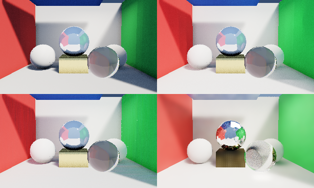
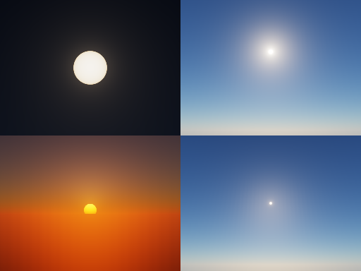
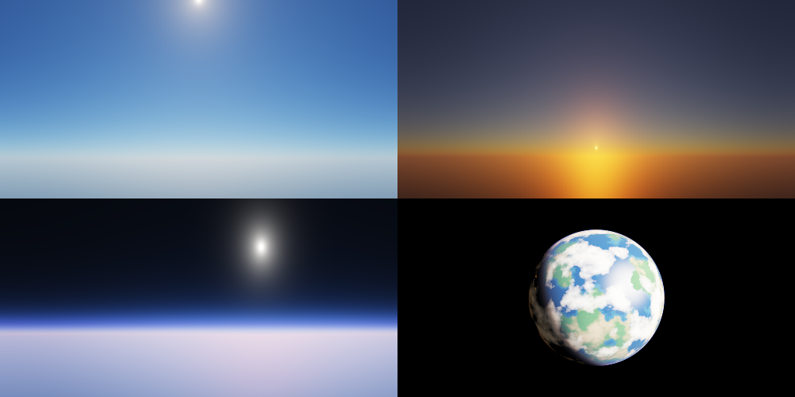
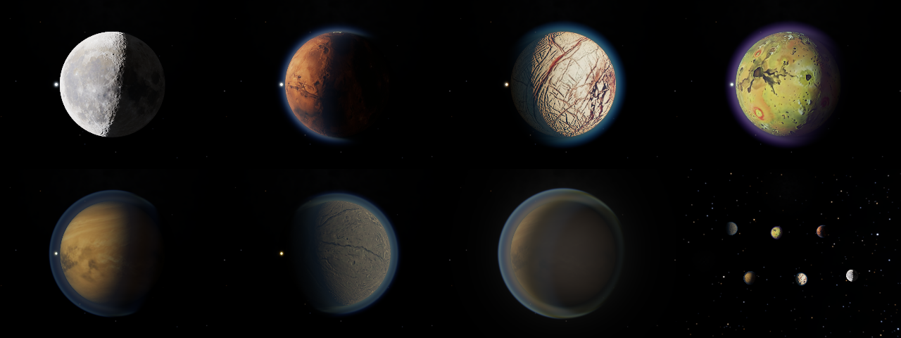
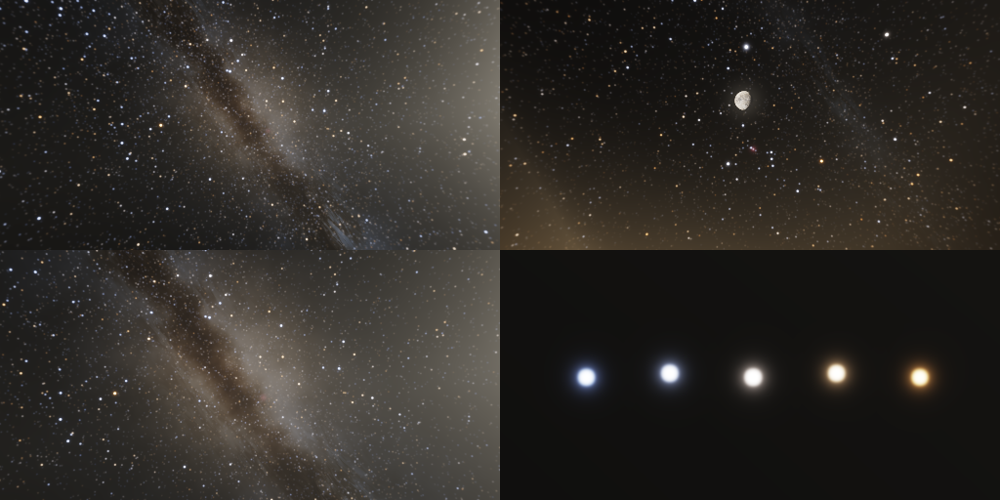
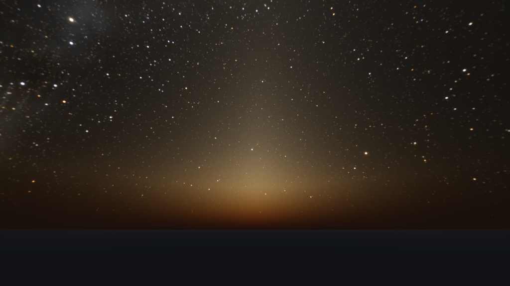
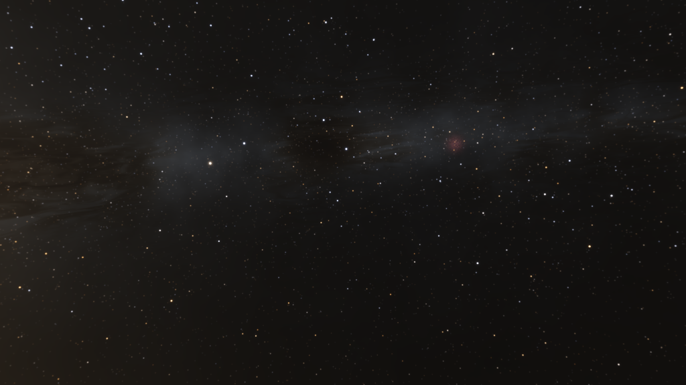
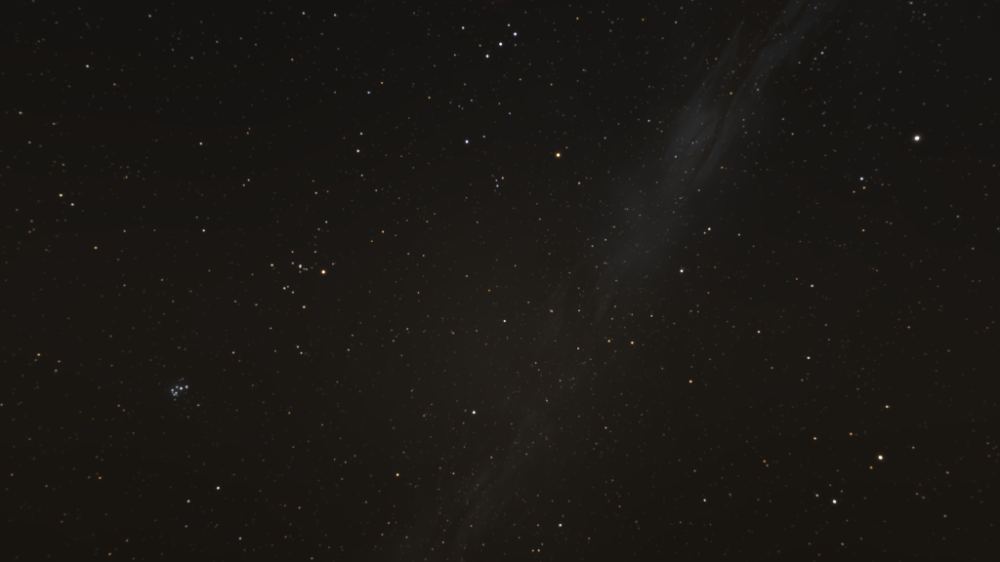
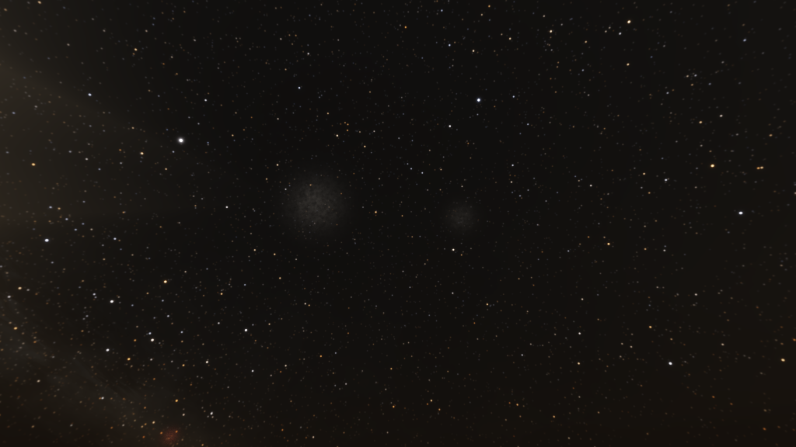

# Audit Proof — Rendering Verification & Celestial Starfield Presets

Verified C++20 & `.slang` visual exhibits exported directly from `Engine/GeometricRaster/` (mirroring both CPU and Vulkan compute paths). Canonical archive copies are also stored under `Exhibits/Images/`.

---

## Stage 1–5 Engine Verification Proofs

### 1. Stage 1 — Hybrid ReSTIR + Dynamic Probe GI + 5-Pass SVGF
- **Exhibit Path:** `Exhibits/Images/GlobalIllumination/06-HybridRestirDynamicProbeGiProof.png`

### 2. Stage 2 — Neckel & Labs (1994) Solar Photosphere, Sub-Pixel `SolarErf`, 3-Term K/F Corona & Glare
- **Exhibit Path:** `Exhibits/Images/Atmosphere/06-Stage2SolarOpticsProof.png`

### 3. Stage 3 — Curved-Planet `256x64` Transmittance, `32x32` Multi-Scatter, `192x108` SkyView LUTs & Orbital Shell
- **Exhibit Path:** `Exhibits/Images/Atmosphere/07-Stage3AtmosphericScatteringProof.png`

### 4. Stage 4 — Six Simultaneous Moons (`Luna`, `Ember`, `Glacier`, `Sulfur`, `Shroud`, `Shard`) with 3D Exospheres, Umbra & 4x4 Stratified Regolith AA
- **Exhibit Path:** `Exhibits/Images/Atmosphere/08-Stage4LunarExospheresProof.png`

### 5. Stage 5 — IAU J2000 Galactic Bulge, Great Rift, 1640 Yale BSC5 + 66K Deep-Field Stars & `Erf`/Moffat PSF
- **Exhibit Path:** `Exhibits/Images/Atmosphere/09-Stage5GalacticStarfieldProof.png`

---

## Astronomical Starfield Presets (`StarfieldPresetIdentifier`)

### 6. Preset: `ZodiacalLightDusk` — Steep Southern-Spring Evening Ecliptic Cone & Astronomical Twilight
- **Exhibit Path:** `Exhibits/Images/Atmosphere/10-ZodiacalLightDusk.png`
- **Physics:** Leinert et al. (1998) 16-knot log-log S10 profile + `45 S10` Gegenschein + silicate solar spectrum `(1.0, 0.93, 0.80)`, smooth pole & ecliptic-plane transitions, `LST 18.0h`, `SunEl -19°` due West.

### 7. Preset: `SouthernCrossCoalsack` — Crux, Coalsack Dark Nebula, Alpha/Beta Centauri & Carina
- **Exhibit Path:** `Exhibits/Images/Atmosphere/11-SouthernCrossCoalsack.png`
- **Physics:** `LST 12.5h` looking South (`El 48°`, `FOV 70°`) featuring Alpha/Beta Centauri, Acrux, Mimosa, Gacrux, Coalsack dust extinction lobe, and NGC 3372 Carina H-II emission.

### 8. Preset: `WinterHunterBetelgeuse` — Orion (Betelgeuse, Rigel, Belt, M42), Sirius, Aldebaran & Pleiades M45
- **Exhibit Path:** `Exhibits/Images/Atmosphere/12-WinterHunterBetelgeuse.png`
- **Physics:** `LST 5.6h` looking North (`El 46°`, `FOV 72°`) contrasting red Betelgeuse against blue-white Rigel, Belt stars, M42 emission & [O III] Trapezium cavity, M45 Merope reflection nebulosity, Hyades/Aldebaran, and Sirius.

### 9. Preset: `MagellanicClouds` — Large & Small Magellanic Clouds, Achernar & Canopus
- **Exhibit Path:** `Exhibits/Images/Atmosphere/13-MagellanicClouds.png`
- **Physics:** `LST 3.0h` looking South (`El 40°`, `FOV 90°`) showcasing LMC (`RA 5.392h, Dec -69.76°`), SMC (`RA 0.877h, Dec -72.83°`), Achernar, Canopus, and Carina.

