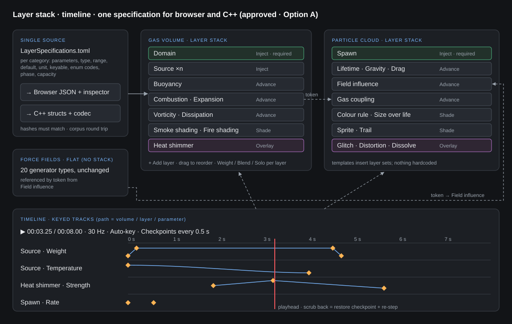
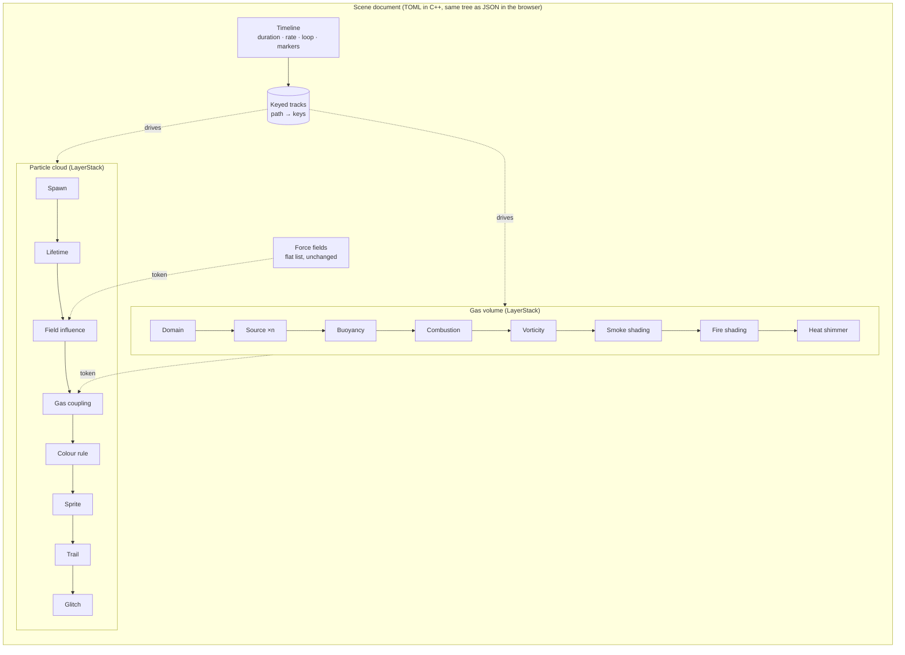
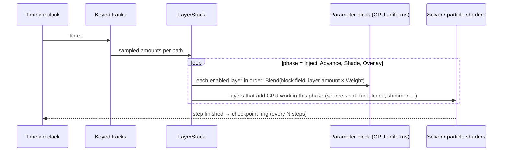
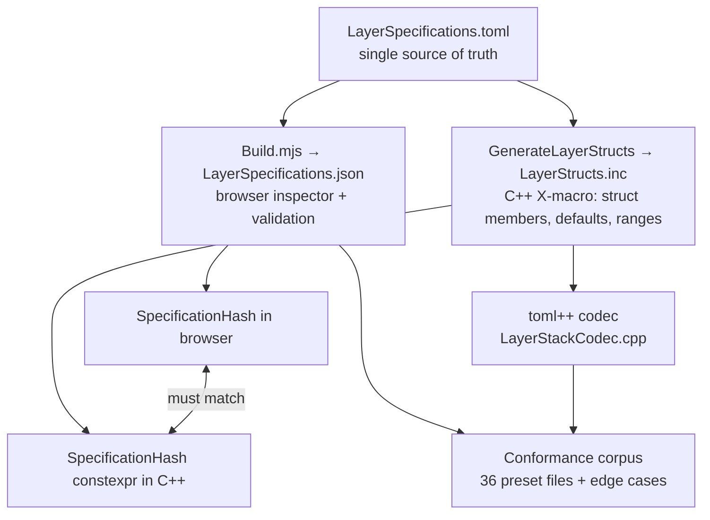
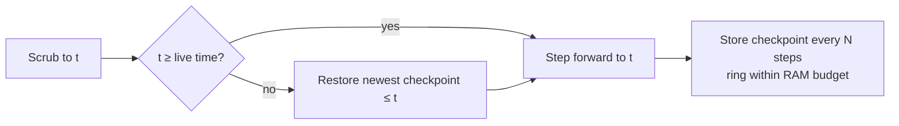

# Fluid and Particle Layer Stack, Timeline and Keying — Plan

**Status: ✔️ approved 2026-11-16 (Option A on decisions 1–5; the fourth phase is named `Overlay`). Names in decision 6 still pending.**
**Scope of this round: HTML/browser only.** Phases 1 and 2 are built in `Experimental/FluidEditor` (see §7); phase 6 (C++) waits.
Scope: `Experimental/FluidEditor` (combined fluid editor) and its particle module; later C++ port. Force fields stay flat (no stack).
Verified against: `ForceGeneratorCatalog.js`, `ParticleCatalog.js`, `PyroScenePresets.js`, `FluidStudioApp.js` at `4c8f7c0` (the original
survey; since phase 2 `PyroScenePresets.js` is no longer loaded and §1 "Today" describes the code before the stack).

**TL;DR** — Every preset becomes data: an ordered **layer stack** per gas volume or particle cloud, each layer an instance of a
typed **layer specification** shared by the browser and C++. Every numeric parameter can carry a **keyed track** on one timeline.
One specification file generates the browser inspector *and* the C++ structs plus codec, and a parity test fails the port if any
field, range, default or behaviour is dropped. That is the guard against another simplified port.



---

## 1. Today versus planned

| Area                  | Today (inspected)                                                                 | Planned                                                        |
|-----------------------|-----------------------------------------------------------------------------------|----------------------------------------------------------------|
| Presets               | 36 hardcoded objects: 18 `StudioScenePresets` + 18 pyro (via `translatePyroPreset`) | 36 stack documents converted by script, numerically checked     |
| Gas parameters        | One flat `Domain` block (20 keys seen) plus a `Look` block                       | Domain layer + optional behaviour layers (buoyancy, combustion …) |
| Particles             | 26 templates, each a flat `Defaults` blob (56 distinct keys)                      | Particle stack: spawn → motion → appearance → effect layers     |
| Timing                | `StartTime / Duration / Fade / Repeat` envelope on forces and sources only         | Keyed tracks on any parameter; envelope converts exactly (§5.3)  |
| Scrubbing             | Not possible (stateful solver; only `SceneLoop` restart)                         | Checkpoint ring + deterministic re-simulation (§5.4)            |
| New effects           | Edit catalogue code                                                               | **+ Add layer** from a menu; unknown layers round-trip inert    |
| C++ conversion        | No shared contract → a port could silently simplify                              | One specification → generated structs, codec, parity tests      |
| Force fields          | 20 generator types, flat scene list                                               | Unchanged. Layers reference them by token (`Field influence`)    |

---

## 2. Architecture



| Term (proposed)          | Meaning                                                                                       |
|--------------------------|-----------------------------------------------------------------------------------------------|
| `GasVolume`              | One Eulerian grid and its `LayerStack`.                                                       |
| `ParticleCloud`          | One GPU particle set (≤ 16 384 today) and its `LayerStack`.                                   |
| `LayerStack`             | Ordered list of `EffectLayer`; top-to-bottom = evaluation order within each phase.            |
| `EffectLayer`            | `{Token, Category, Enabled, Solo, Weight, Blend, Parameters}`; Category picks its specification. |
| `LayerSpecification`     | Static description of one category: parameters, phase, capacity, GPU work it adds.            |
| `ParameterSpecification` | `{Name, Type, Minimum, Maximum, Default, Unit, Keyable, Code}`; one per field, shared by browser and C++. |
| `KeyedTrack`             | `{ParameterPath, Keys[], Extrapolation}`; path = `Volume/Layer/Parameter`.                    |
| `TrackKey`               | `{Time, Amount, Ease, InTangent, OutTangent}`.                                                |

### 2.1 Phases and evaluation per simulation step



| Phase     | Gas layers                                                     | Particle layers                                        |
|-----------|----------------------------------------------------------------|--------------------------------------------------------|
| Inject    | Domain (required, first), Source, Debris spawn                  | Spawn (required, first), Cloner formation              |
| Advance   | Buoyancy, Combustion, Expansion, Vorticity, Dissipation, Collision | Lifetime, Gravity, Drag, Noise, Field influence, Gas coupling, Bounce, Home spring |
| Shade     | Smoke shading, Fire shading, Fire light, Self-shadow            | Size over life, Colour rule, Sprite, Trail             |
| Overlay | Heat shimmer                                                   | Glitch, Distortion, Dissolve (derez)                   |

- **Blend** (contributing layers): `Replace · Add · Multiply · Maximum`. Two Source layers add GPU work; two Buoyancy layers blend.
- **Weight** (0–1, keyable) scales the layer's contribution; Weight 0 = no GPU work issued.
- **Solo / Mute** are editor-only and are not saved into an exported bake.

### 2.2 Inspector layout (layer stack)

```
┌ Inspector ─ Campfire · Gas volume ─────────────────────────┐
│ LAYERS                                    [+ Add layer ▾]   │
│ ≡ ◉ Domain          48×80×48 · 3×5×3 m        (required)    │
│ ≡ ◉ Source          Fire Source · disc 0.42 m   ◆ keyed     │
│ ≡ ◉ Combustion      rate 1.5 · expansion 0.6               │
│ ≡ ○ Vorticity       0.25          (muted)                   │
│ ≡ ◉ Fire shading    5.5 × · softness 3.0                    │
│ ≡ ◉ Heat shimmer    0.45 · from 0 m                         │
├─────────────────────────────────────────────────────────────┤
│ SELECTED LAYER · Source                [Weight 1.00 ◆] [⋯] │
│   Shape  Disc ▾     Radius ──●──── 0.42 m ◇                 │
│   Temperature ───●── 5.0 ◆   Fuel ──●─── 1.3 ◇              │
└─────────────────────────────────────────────────────────────┘
 ≡ drag to reorder · ◉/○ enable · ◆ keyed here · ◇ keyable, no key
```

---

## 3. Data model that survives the C++ port

### 3.1 Rules

| # | Rule                                                                                         | Why                                         |
|---|----------------------------------------------------------------------------------------------|---------------------------------------------|
| 1 | Every parameter has one of 9 types: `Float32 Int32 UInt32 Bool Vector3 ColourLinear Choice Ramp8 Token` | Each maps to exactly one C++ type          |
| 2 | Choices are closed enums with **explicit integer codes**, never list positions                | Reordering a menu cannot change saved files |
| 3 | Lists have fixed capacities in the specification (`Source ≤ 6`, `Ramp8 = 8 stops`, `Layers ≤ 32`) | C++ uses `std::array` + count; no hidden caps |
| 4 | SI units in files (m, s, K, m/s); display units only in the UI                                | No silent rescaling during porting          |
| 5 | Unknown category or parameter → kept verbatim as an inert layer and written back unchanged     | Newer files never lose data in older builds |
| 6 | Each file and each layer specification carries a revision; upgrades are explicit functions      | No guessing at load                         |
| 7 | Colours stored as linear float RGBA; the UI converts to and from sRGB hex                     | The browser and C++ shade the same numbers  |

### 3.2 One source, two outputs



- **Round trip:** browser writes each corpus file → C++ reads → writes → byte-identical TOML. Any dropped field fails.
- **Behaviour parity:** the existing `FluidMetrics` probe (mean speed, vorticity, density at 1/4/7/10 s) runs in the browser and in
  C++; each preset must agree within a stated tolerance. A simplified port fails here, not after delivery.
- **Coverage check:** a script lists every `ParameterSpecification` and fails if the C++ solver never reads it (grep for its
  generated accessor), so a field cannot be parsed and then ignored.

### 3.3 Sample (browser JSON and C++ TOML hold the same tree)

```toml
[Document]
Format = "frontier-effect-stack"   # proposed
Revision = 1
SpecificationHash = "…"

[[Volume]]
Token = "gas-campfire"
Category = 1                        # 1 GasVolume, 2 ParticleCloud

  [[Volume.Layer]]
  Token = "layer-source-1"
  Category = 102                    # Source
  Enabled = true
  Weight = 1.0
  Blend = 0
  Parameters = { Shape = 1, Position = [0.0, -2.3, 0.0], Radius = 0.42, Density = 0.3, Temperature = 5.0, Fuel = 1.3 }

[[Track]]
Path = "gas-campfire/layer-source-1/Temperature"
Keys = [ { Time = 0.0, Amount = 5.0, Ease = 2 }, { Time = 4.0, Amount = 3.2, Ease = 2 } ]
```

```cpp
// 📝 Generated from LayerSpecifications.toml; edit the specification, never this file. Ranges here are illustrative.
struct SourceLayerParameters
{
    uint32_t Shape       = 1;                    // Choice: 0 Sphere, 1 Disc, 2 Box
    float    Position[3] = {0.0f, -1.5f, 0.0f};  // m
    float    Radius      = 0.4f;                 // m, 0.02–3
    float    Density     = 1.0f;                 // 0–4
    float    Temperature = 2.0f;                 // 0–8
    float    Fuel        = 0.0f;                 // 0–3
};
```

---

## 4. Presets become stacks

| Current preset field                        | Becomes                                                     |
|---------------------------------------------|-------------------------------------------------------------|
| `Domain.Resolution / Size / Grid / Tiles`   | Domain layer                                                |
| `Domain.Buoyancy / AmbientTemperature / Cooling` | Buoyancy layer                                         |
| `Domain.Combustion / Expansion`             | Combustion layer                                            |
| `Domain.Vorticity / Dissipation / VelocityDissipation` | Vorticity and Dissipation layers                  |
| `Emitters[n]`                               | Source layer per entry (path, debris → Debris spawn layer)  |
| `Look` (Albedo, Absorption, Fire*)          | Smoke shading and Fire shading layers                       |
| `Visualizers.Debris`                        | A linked particle cloud with Spawn ← Debris spawn token     |
| `Forces[n]`                                 | Stay force fields (flat), unchanged                         |

- **Conversion is mechanical**: one script writes all 36 documents; the old objects are deleted only after `FluidMetrics` matches
  before and after for each preset.
- **New effect**: `+ New gas volume` creates Domain only; `+ New particle cloud` creates Spawn + Sprite. Templates insert layer
  sets, they are not code.
- **Cannot fail silently**: a stack missing its required first layer, or over a capacity, shows a red badge on the layer and the
  volume stops simulating with the reason in the status bar. The rest of the scene keeps running.

### 4.1 Particle layers as built (phase 3)

The §2.1 particle list is built with two merges, so each of the 54 GPU fields of a particle node has exactly one owning layer:

| Code | Layer           | Phase   | Owns                                                                  | Neutral (no layer)               |
|------|-----------------|---------|-----------------------------------------------------------------------|----------------------------------|
| 201  | Spawn (required)| Inject  | Mode, Shape, Position, Direction, Radius, Fill, Count, Rate, **Lifetime**, Linger, Speed, Spread, Radial | — (always present) |
| 202  | Home spring     | Advance | Spring, Damping, Dissolve (the "Cloner formation" is Spawn Mode + Shape + Fill) | standard spring 6 / 3, no dissolve; Emit never reads it |
| 203  | Gravity         | Advance | Gravity                                                               | 0                                |
| 204  | Drag            | Advance | Drag                                                                  | 0                                |
| 205  | Noise           | Advance | Noise, NoiseScale, NoiseSpeed                                         | 0 (scale 1.3, speed 0.5)          |
| 206  | Field influence | Advance | FieldInfluence                                                        | 0 = force fields ignored          |
| 207  | Gas coupling    | Advance | GasInfluence                                                          | 0                                |
| 208  | Bounce          | Advance | Bounce                                                                | −0.05 = pass through the floor    |
| 209  | Colour rule     | Shade   | ColourMode, Palette (Ramp8), RampSource, Ramp, MaxSpeed, DisplacementRange, CycleSpeed, HueJitter, BrightnessJitter, Brightness, Flicker | life gradient white → grey |
| 210  | Size over life  | Shade   | SizeMode, SizeStart, SizeEnd, SizeRandom                              | 3 → 1 px                          |
| 211  | Sprite          | Shade   | Sprite, Glow, Blend, Style, FocusDistance, Aperture                   | disc, alpha, no depth of field    |
| 212  | Trail           | Shade   | Trail, TrailLength … TrailRatio (9)                                   | off                              |

- **Merges:** *Lifetime* sits in Spawn (an emitter without a lifetime has no meaning); *Cloner formation* is Spawn's Mode/Shape/Fill
  and *Home spring* holds the spring. Names stay pending with decision 6.
- **Flat on the node:** only identity (Id, Template, Name, Enabled, Visible) and timing (StartTime, Duration, Fade, Repeat — phase 4
  turns timing into a keyed Weight track).
- **Templates:** `ParticleTemplates/<id>.toml` (`frontier-particle-template`): `[Template]`, optional `[Timing]`, `[[Layer]]`. A new
  instance copies the template's layers; overrides go into their owning layers (a missing layer is inserted in phase order at the
  node's current amounts). *Empty Cloud* is the `+ New particle cloud` starting point (Spawn + Sprite).
- **Presets:** each `[[Particle]]` entry holds Template, Name, timing and its `[[Particle.Layer]]` list.

---

## 5. Timeline and keying

### 5.1 Layout

```
┌ Timeline ───────────────────────────────────────────────────────────────────────┐
│ ⏮ ◀ ▶ ⏭  ⟲ loop   00:03.25 / 00:08.00  @ 30 Hz   Auto-key ●   Checkpoints ▮▮▮▯ │
│          0s     1s     2s     3s │   4s     5s     6s     7s     8s              │
│ ▾ Campfire (gas)                 │                                              │
│   ▾ Source · Fire Source         │                                              │
│       Weight          ◆──────────┼──◆                                           │
│       Temperature     ◆──────────┼────────◆                                     │
│   ▸ Heat shimmer                 │      ◆        ◆                              │
│ ▾ Embers (particles)             │                                              │
│   ▸ Spawn             ◆  ◆       │                                              │
│ [Dope sheet] [Curves]            ▲ playhead                                     │
└─────────────────────────────────────────────────────────────────────────────────┘
```

### 5.2 Keys

| Item          | Proposal                                                                                         |
|---------------|--------------------------------------------------------------------------------------------------|
| Keyable types | `Float32 Int32 Vector3 ColourLinear Bool Choice` (Bool and Choice step only)                    |
| Ease codes    | `0 Constant · 1 Linear · 2 Smooth (cubic Hermite, auto tangents) · 3 Bezier (explicit tangents)`  |
| Extrapolation | `Hold · Cycle · Ping-pong` per track                                                             |
| Editing       | ◆ beside any slider; Auto-key writes a key on edit; dope sheet moves/scales keys; curve view edits tangents |
| Precedence    | Keyed amount replaces the static parameter; layer Weight multiplies after                        |

### 5.3 Existing envelope converts exactly

`timingEnvelope` = `min(rise, fall)` with linear ramps, so it is a 4-key linear track on **Weight**:

| Case                     | Keys (time → amount)                                                                     |
|--------------------------|------------------------------------------------------------------------------------------|
| `Duration = 0`           | `Start → 0`, `Start + Fade → 1`, hold                                                     |
| `Fade ≤ Duration / 2`    | `Start → 0`, `Start + Fade → 1`, `Start + Duration − Fade → 1`, `Start + Duration → 0`    |
| `Fade > Duration / 2`    | `Start → 0`, `Start + Duration/2 → Duration/(2·Fade)`, `Start + Duration → 0` (triangle)  |
| `Repeat > 0`             | Same keys, track extrapolation = Cycle with period `Repeat`                              |

A unit test samples old and new at 1 ms steps for every keyed force and source in the 36 presets: maximum difference must be ≤ 1e-6.

### 5.4 Scrubbing a stateful simulation



- Checkpoint = velocity, density/temperature/fuel, pressure (warm start) and particle textures, plus the random seed and step index.
- Budget example (proposal): 64³ cells × half-float velocity, scalars and pressure ≈ 5 MB per checkpoint → 32 checkpoints ≈ 160 MB,
  default one every 0.5 s. The budget is a setting; the ring drops the oldest checkpoint first.
- Determinism: fixed step and seeded noise already exist; checkpoint restore + re-step must reproduce the live run bit-for-bit
  in the browser (tested by hashing a read-back after scrubbing back and forth).
- Flipbook bake (Follow-up 47) reuses the same clock, so a bake follows the keyed timeline.

### 5.5 As built (phase 4)

| Piece | File | What it does |
|-------|------|--------------|
| Tracks | `Engine/KeyTracks.js` (no imports) | Sampling (ease 0–3, Hold / Cycle / Ping-pong, colours in linear light, Int rounds, Bool / Choice / palette / token step), `setKey`, `removeKey`, `transformKeys` (move / scale about a pivot), `envelopeToTrack`, `nodeWeight`, `keyedNode`, `affectedFrom` |
| Stack keys | `Engine/LayerStack.js` | `evaluateLayerStack(stack, emitters, time)`: a keyed amount replaces the static one before blending, layer Weight is keyable and multiplies after. No time = the static fold (what files and fingerprints use) |
| Force / source / cloud keys | `Engine/ForceGeneratorCatalog.js`, `FluidSolver.js`, `ParticleSimulation.js` | Force and source fields are keyed on the node (`node.Tracks`, paths = field names); the solver packs `keyedNode(node, t)` and multiplies by `nodeWeight(node, t)` |
| Timing → Weight | `KeyTracks.envelopeToTrack` | Start / Duration / Fade / Repeat generate the Weight track (§5.3). The timeline shows it as a *derived* track; dragging one of its keys, or ◆ on Weight, turns it into explicit keys and clears the timing fields. Setting timing again hands Weight back to the envelope |
| Checkpoints | `Engine/SimulationCheckpoints.js` · `CheckpointRing` | Every 0.5 s: velocity, state, pressure, curl, tracers, debris, every particle record (positions, velocities, previous, trails) via GPU copies (`GpuContext.copyTarget`), plus clock, step index, sparse tile pool and grid origin. Budget 192 MB, at most 64; restores only into the same layout |
| Scrubbing | `Engine/FluidStudioApp.js` | `seek(t)` restores the newest checkpoint ≤ t (or restarts at 0) and re-steps, 24 ms of steps per frame; `seekNow(t)` is the synchronous form. Static edits drop every checkpoint; a key edit drops those after `affectedFrom` (two keys back, since Smooth tangents reach that far) and **re-simulates** from the surviving checkpoint to the playhead, so the picture, later checkpoints and a scrub back agree. Loop wraps at the timeline End |
| Timeline dock | `UI/TimelinePanel.js` under the viewport | Transport (⏮ step-back ▶ step ⏭), timecode, End, Loop, Auto-key, checkpoint bar; dope sheet grouped by gas volume / force / source / cloud (drag = move snapped to the 240 Hz step, Alt = free, Ctrl = scale about the playhead; ruler and lanes scrub); curves view (SVG) with key and Bezier tangent drag; ease, extrapolation, delete; Delete, Home, End, `,` `.`, Ctrl+A |
| Inspector | `UI/StudioPanels.js` | ◆ beside every keyable control (outlined = not keyed, amber = keyed, filled = key at the playhead); keyed controls show the amount at the playhead; an edit of a keyed amount writes a key; Auto-key keys every edit |
| Files | presets / scene JSON | `[[Force.Track]]`, `[[Emitter.Track]]`, `[[Volume.Track]]`, `[[Particle.Track]]` (+ `.Keys`), preset Revision 2, `[Timeline]` End / Loop; scene JSON Version 5. The 36 library presets have no explicit keys, so their documents are unchanged |

---

## 6. Visual effect layers (from earlier workspaces)

| Layer (proposed)  | Stack    | Source in repo                                                              | Parameters (initial)                                        |
|-------------------|----------|-----------------------------------------------------------------------------|-------------------------------------------------------------|
| Heat shimmer      | Gas      | `ProjectZeroEditor/PostEffects.jsx` heat-shimmer sheet                     | Strength 0–1, Scale 0.25–4, Speed 0–4, Temperature threshold, Height falloff 0–1 |
| Glitch            | Particle | `PostEffects.jsx` glitch sheet; `SlateReference/…/EffectSequence.js` "Glitch dissolve" | Intensity 0–1, Frequency 0–10 Hz, Block size 2–64 px, RGB split 0–24 px, Scanline jitter 0–1, Colour (#ff2d6f) |
| Distortion        | Particle | new: refractive sprite                                                      | Strength, Radius, Chromatic split, Falloff                  |
| Dissolve (derez)  | Particle | `EffectSequence.js` "Derez cube", "Reverse derez"; `ParticleEditor` `SweepJag` edge | Wave, Burst, Speed range, Drag, Life, Size, Glow / Hot colours |

- **Heat shimmer** is driven by the gas temperature: the volume march writes a screen-space offset buffer (temperature ×
  thickness), then a refraction step offsets the scene. Not a full-screen post effect: only hot gas distorts.
- **Glitch and distortion** run per particle in the Overlay phase, so they apply to one cloud only and can be keyed.

---

## 7. Delivery phases (after approval)

| Phase | Deliverable                                                                  | Verification                                                     |
|-------|------------------------------------------------------------------------------|------------------------------------------------------------------|
| 1 ✔️  | `LayerSpecifications.toml` + browser loader + inert-unknown round trip        | Round-trip unit tests; specification hash printed                 |
| 2 ✔️  | Gas stack evaluation; 36 presets converted; old preset objects removed        | `FluidMetrics` per preset before/after; `FluidValidation`         |
| 3 ✔️  | Particle stack; 26 templates converted                                        | Template capture before/after; particle counts and colours        |
| 4 ✔️  | Timeline, keys, auto-key, curves, checkpoints, scrubbing                      | Envelope conversion test (≤ 1e-6); scrub determinism hash         |
| 5     | Heat shimmer, glitch, distortion, dissolve layers                             | Captures + parameter sweeps in `Exhibits/FluidEditor/`            |
| 6     | C++: generated structs, toml++ codec, conformance corpus, metric parity       | Windows build; byte round trip; metric parity table               |

---

## 8. Decisions needed

| # | Decision              | Option A                                     | Option B                              | Option C                    | Recommendation |
|---|-----------------------|----------------------------------------------|---------------------------------------|-----------------------------|----------------|
| 1 | Source of truth       | ⭐ Specification TOML generates JS and C++ ✔️ | Hand-written C++ header, JS mirrors 🚩 | JS catalogue is truth 🔴     | A              |
| 2 | Scrub model           | ⭐ Checkpoint ring + re-step ✔️               | Re-simulate from 0 on every scrub 🚩   | Scrub baked flipbooks only 🔴 | A              |
| 3 | Debris and embers     | ⭐ Linked particle cloud (token) ✔️           | Keep inside the gas solver 🚩          | —                           | A              |
| 4 | Force fields          | ⭐ Flat, referenced by token ✔️ (your brief)  | Own stack 🚩                           | —                           | A              |
| 5 | Phase 1 + 2 first     | ⭐ Yes, gas first, then particles ✔️          | Particles first 🚩                     | Both at once 🔴              | A              |
| 6 | Names                 | As proposed here                              | Your replacements                      | —                           | You decide     |

**Decisions 1–5: Option A, approved. Decision 6 (names): pending.**

### 8.1 Progress (HTML only)

| Phase | State | What exists |
|-------|-------|-------------|
| 1 | ✔️ done | `Engine/LayerSpecifications.toml` (8 gas categories, codes 101–108) → `GenerateLayerSpecifications.mjs` → `Engine/LayerSpecifications.js` + hash; `Engine/TomlSubset.js` reader/writer; `Engine/LayerSpecificationValidation.js` rules + FNV-1a 64 hash; unknown categories and parameters kept verbatim. |
| 2 | ✔️ done | `Engine/LayerStack.js` evaluates the gas stack into `scene.Domain` / `Visualizers.Volume` (GPU code unchanged). Inspector stack UI (add, enable, reorder, weight, blend, solo, delete). **Presets are documents:** `Presets/*.toml` (36, `frontier-fluid-preset`) → `GeneratePresetLibrary.mjs` → `Engine/PresetLibrary.js`; loaded by `Engine/PresetScenes.js`. Legacy objects removed from the runtime after all 36 rebuilt identical scenes (fingerprints in `Exhibits/FluidEditor/Results/PresetConversion.json`) and FluidMetrics matched exactly on Campfire, Smoke Plume, Tornado, Wind Tunnel. *Save as preset* writes a document. Scene JSON Version 3 carries `GasStack`. `PyroScenePresets.js` is kept as an unloaded 📝 reference of the original values. |
| 3 | ✔️ done | Particle categories 201–212 (§4.1) in the same specification (hash `c0d4526879189117`). Every particle system carries `node.Stack`; the node's flat fields are its evaluation, so the GPU code only gained a "held" check. **Templates are documents:** `ParticleTemplates/*.toml` (26 converted + *Empty Cloud*) → `GeneratePresetLibrary.mjs` → `Engine/ParticleTemplateLibrary.js`. Preset `[[Particle]]` entries carry `[[Particle.Layer]]`. Inspector: particle stack (add, enable, weight, blend, solo, reorder, delete) + selected-layer settings (palette editor, World/Pixel size ranges, only the settings that apply); gizmo moves write the Spawn layer. Scene JSON Version 4. Checks: 26/26 templates rebuild the identical node, 36/36 presets the identical scene; GPU capture of all 26 templates (live count, mean position, speed, changed pixels, mean colour at 1 s and 2.5 s) identical before and after (`Exhibits/FluidEditor/Results/ParticleTemplateConversion.json`). |
| 4 | ✔️ done | §5.5. Checks: envelope → Weight track over every timed force, source and cloud in the 36 presets (27 nodes, 104 127 samples at 1 ms) max difference 1.1e-15, plus 300 synthetic timing cases 2.2e-13; 36/36 presets and 26/26 templates still rebuild identical scenes and nodes; FluidMetrics on Campfire, Smoke Plume, Tornado, Wind Tunnel identical to phase 2; **scrub determinism** (browser read-back hash of every checkpointed texture after straight run, forward-then-back, back-then-forward, 5 steps back, and a cold run): identical for Campfire, Campfire with keys and Form (two particle clouds) — `Exhibits/FluidEditor/Results/ScrubDeterminism.md`. ⚠️ Sparse (infinite) grids: restore + re-step is checked on the mock GPU only; the browser run did not finish within 25 min on SwiftShader. FluidValidation §9 (49 checks). |
| 5 | ✔️ done | Effect layers 213–218 (Dissolve & Derez, Mocap performer, MoGraph effector, Flock & Swarm, Glitch, Distortion & Lensing) plus gas 109 Heat shimmer, all evaluated through `LayerStack` with Overlays and Gizmos off by default. Validation §12. |
| 5.1 | ✔️ done | **3D object carriers and object-surface spawn** (§4.1 extension). Layer 211 is now *Sprite & Object*: `CarrierMode` Sprite ↔ Object3D, a shared 19-mesh catalogue (`Engine/ObjectMeshCatalog.js`: 10 061 procedural triangles), `ObjectSpin/Tilt/Roughness/Metallic/Glow`, and nine new analytical sprite cutouts (9–17). Layer 201 gained `ObjectSurface` (area-weighted `EvenSurface / SurfaceVolume / RidgeAccent` anchors baked to `RGBA32F`), `Spiderweb`, `ClothGrid`, `FloraBed`, `FireworkBurst`, `SpawnObject`, `SpawnSampleMode`, `ObjectYaw`, `BackingSurface` (obsidian / chrome / ghost wireframe) and a shared `CustomObjectId`. Custom `.obj` / `.stl` / `.json` import from the Inspector on either layer and by dropping a file on the viewport. Rendering is `gl_VertexID`-instanced from a texel mesh (`drawArrays` only, no vertex buffers or divisors). Schema hash `a214aa4e57e2d742`; 54 templates, 46 presets; validation §13 (18 checks). Evidence: `Exhibits/FluidEditor/Results/ObjectCarriers_*.png`. |
| 6 | ⏸ | C++ — out of scope this round (HTML only). |
