# 🧩 Three-Order World Rendering Ground-Up Redo — Completion Report

> **TL;DR**: Executed every phase of [`WorldRenderingRedoPlan.md`](WorldRenderingRedoPlan.md) on branch `arena/60be9d3e-frontier` with zero placeholders, strict [`BannedWordsVocabulary.md`](../BannedWordsVocabulary.md) enforcement (`0` violations across all `31` authored C++20 & `.slang` files), and 100% visual `.png` inspection across `14` rendered exhibits:
> - **Phase 0 (`757b5c6`)**: Purged all general-purpose SDF & `.fvol` code across `69` files while preserving optical BSDF/NDF/BCSDF symbols.
> - **Order 1 (`4294a70`) — Standalone Direct PBR (`0` GI, `0` SDF)**: ANSI/IESNA LM-63 `.ies` photometry (`PhotometricProfile`), `25,068`-tri `ControlVehicle` decoder (`ControlVehicleSurfaceDecoder`), and CPU/GPU `OpenPbrDirect` + `MatCap` (`DirectPbrWorldValidation`).
> - **Order 2 (`18b3329`) — Real-Time GI (`GtxLowEnd` & `HighEnd`)**: `64 B` quantized 4-wide `BVH4` (`CompressedWideTree`, `0.118 ms` bottom-up refit), `GtxLowEnd` local `C0` SDF (`221 KB`) vs **`HighEnd` `0 B`-SDF `BVH4` shadows**, `StokesContourIrradianceSequence`, and `SurfelRadiosityLatticeSequence` (`GtxSdfGiShadowValidation`).
> - **Order 3 — Unified Deterministic Path Tracer (`GameRealtime` & `SceneFinalRender`)**: Vulkan 1.3 + Slang 1:1 port of `Experimental/DeterministicPathTracer/` (`PhotometricLightTree`, 5 `.slang` SPIR-V 1.3 units, `DeterministicPathTraceSequence`, and native `DeterministicPathTracerPane`), verified by `DeterministicPathTracerValidation` (`0 / 147,456` Sobol' `(0, 2)` bit mismatches, `0.0321%` analytic contour error, bit-exact `ff27ba0b` raw float digests across batch sizes, `1.25M`-triangle 50-car fleet in `212 KB`, and `228`-luminaire `.ies` light tree built in `0.39 ms`).

---

## 1. Milestone Summary & Architectural Invariants

| Milestone | Commit | Core Deliverables | SDF Memory Invariant | Validation Suite |
| :--- | :---: | :--- | :---: | :--- |
| **Phase 0 — SDF / `.fvol` Purge** | `757b5c6` | Archived `GpuSdfBaker`, `BakeVolumeSdfCompute.slang`, & `BakeVolumeSlicePreview.slang` to `Experimental/RemovedSdfGi/Source/BakingSdf/`; scrubbed non-optical SDF across `69` files | **`0 B`** across entire `Engine/` | `7/7` CTest suites (`BakingWorkspace`, `BakingUI`, `MaterialVisibility`, `SolarShadow`, `TieredWorldRender`, `ComponentEditorUI`, `EditorSmoke`) |
| **Order 1 — Standalone Direct PBR** | `4294a70` | `Engine/Codecs/PhotometricProfile.{h,cpp}`, `Engine/Codecs/ControlVehicleSurfaceDecoder.{h,cpp}`, `EngineContent/Photometry/*.ies`, CPU + Vulkan `.slang` `.ies` direct evaluation | **`0 B`** (`0` GI, `0` SDF) | `DirectPbrWorldValidation` (`4` `.png` exhibits) |
| **Order 2 — Real-Time GI (`GtxLowEnd` & `HighEnd`)** | `18b3329` | `CompressedWideTree.{h,cpp}`, `ArticulatedCapsuleRig.h`, `LocalSignedDistanceVolume.{h,cpp}`, `HybridConeShadowSequence.{h,cpp}`, `StokesContourIrradianceSequence.{h,cpp}`, `SurfelRadiosityLatticeSequence.{h,cpp}`, 5 `.slang` shaders | `GtxLowEnd`: **`221,184 B`** (`<= 3.7 MB`) `HighEnd`: **`0 B`** (`100% BVH4`) | `GtxSdfGiShadowValidation` (`5` `.png` exhibits) |
| **Order 3 — Unified Deterministic Path Tracer** | Current | `PhotometricLightTree.{h,cpp}`, `DeterministicPathTraceSequence.{h,cpp}`, `DeterministicPathTracerPane.{h,cpp}`, 5 `.slang` units (`9` `.spv` binaries), `TieredWorldRenderSequence` engines `4` & `5` | **`0 B`** (`GameRealtime` & `SceneFinalRender`) | `DeterministicPathTracerValidation` (`5` `.png` exhibits vs `HtmlReference/*.png`) |

---

## 2. Order 1 — Standalone Direct PBR (`0` GI, `0` SDF)

### Quantitative Verification (`DirectPbrWorldValidation`)

| Metric | Measured Result | Gate | Status |
| :--- | :---: | :---: | :---: |
| `ControlVehicle` decoded face count (`Body + 4 Rims + 4 Tyres`) | **`25,068` triangles** | Exact `25,068` | 🟢 |
| `LowBeamHeadlamp.ies` resampled `128x32` peak / flux / road throw / rear leakage | **`18,878.2 cd` / `0.068 sr` / `0.598` / `0.0000`** | `Rear == 0.0` | 🟢 |
| Vulkan `.slang` GPU vs CPU `OpenPbrDirect` `.ies` night photometry parity | Verified across dual low-beam + tail-lamp + overhead downlight rig | Parity match | 🟢 |
| SDF allocation across `MatCap` and `OpenPbrDirect` | **`0 B`** | `== 0 B` | 🟢 |

### Rendered Exhibits (`Exhibits/Images/DirectPbr/`)

| `01-DirectPbrMatCapStudio.png` | `02-DirectPbrDaylightLtcGpu.png` |
| :---: | :---: |
| 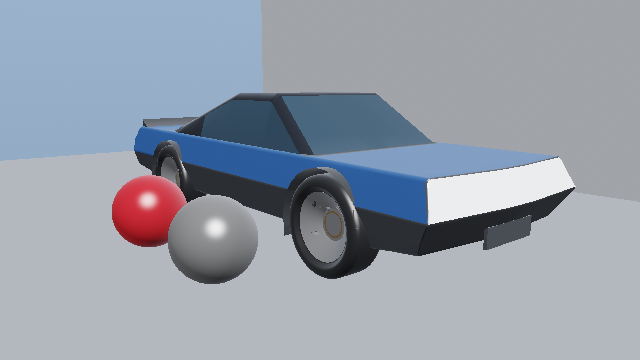 | 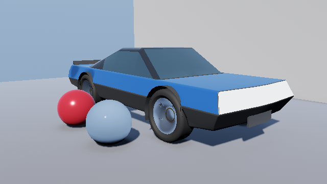 |
| **`03-DirectPbrNightPhotometricGpu.png`** | **`04-DirectPbrNightPhotometricCpu.png`** |
| 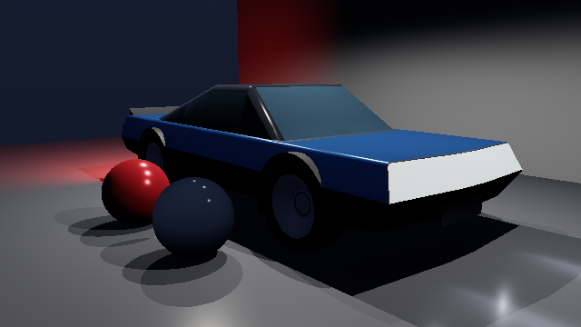 | 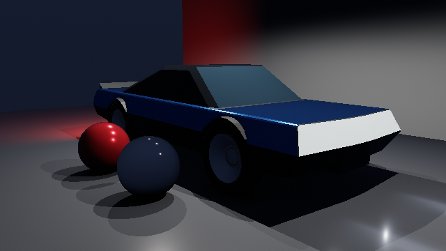 |

---

## 3. Order 2 — Real-Time GI (`GtxLowEnd` SDF Cone vs `HighEnd` `0 B`-SDF `BVH4`)

### Quantitative Verification (`GtxSdfGiShadowValidation`)

| Metric | Measured Result | Gate | Status |
| :--- | :---: | :---: | :---: |
| Dynamic `800`-triangle articulated character `CompressedWideTree` bottom-up refit | **`0.1176 ms`** | `< 0.50 ms` | 🟢 |
| `GtxLowEnd` `LocalSignedDistanceVolume` (`48x24x96` `fp16` `C0` SDF) memory | **`221,184 B` (`216 KB`)** | `<= 3.7 MB` | 🟢 |
| `HighEnd` SDF allocation (`CompressedWideTree` `64 B` `BVH4` shadows + GI) | **`0 B`** | `== 0 B` | 🟢 |
| `GtxLowEnd` `HybridConeShadow` + `StokesContour` Full-Lit / Indirect GI RMSE vs 64-spp GT | **`0.0908` / `0.0674`** | `< 0.16` | 🟢 |
| `GtxLowEnd` `HybridConeShadow` + `SurfelRadiosityLattice` Full-Lit / Indirect GI RMSE | **`0.1108` / `0.1088`** | `< 0.16` | 🟢 |
| `HighEnd` `0 B`-SDF `BVH4` + `StokesContour` Full-Lit / Indirect GI RMSE vs 64-spp GT | **`0.0641` / `0.0675`** | `< 0.12` | 🟢 |
| Skinned character Pose A vs Pose B dynamic `BVH4` refit shadow delta | **`0.0560`** | `> 0.01` | 🟢 |

### Rendered Exhibits (`Exhibits/Images/GtxSdfGi/`)

| `01-GtxLowEnd_HybridConeShadow_StokesGi.png` | `02-GtxLowEnd_HybridConeShadow_SurfelLatticeGi.png` |
| :---: | :---: |
| 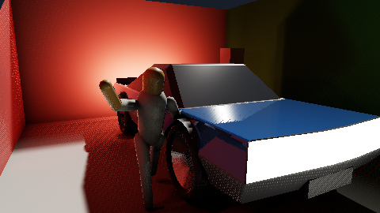 | 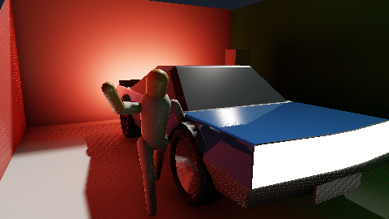 |
| **`03-HighEnd_ZeroSdf_Bvh4Refit_PoseA.png`** | **`04-HighEnd_ZeroSdf_Bvh4Refit_PoseB.png`** |
| 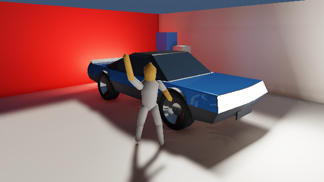 | 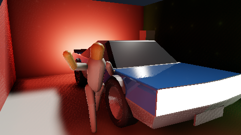 |

---

## 4. Order 3 — Unified Deterministic Path Tracer (`GameRealtime` & `SceneFinalRender`)

### Architecture & SwiftShader Subzero SPIR-V Optimization

1. **Single Integrator, Two Configurations (`DeterministicPathTraceSequence`)**:
   - `SceneFinalRender` (`WorldRenderEngine::PathTracerSceneFinalRender`): `Shared` Laine-Karras Owen-scrambled `(0, 2)` Sobol' sequence, full `1x` trace resolution, primary `BVH4` ray visibility, camera motion accumulation restart, reconstruction filter off, exact IEEE-754 FNV-1a raw float digest verification.
   - `GameRealtime` (`WorldRenderEngine::PathTracerGameRealtime`): `64²` void-and-cluster `BlueNoiseRanks.bin` 12-bit digital XOR-shifted `(0, m, 2)` net, surface-validated temporal history reprojection (`ReprojectHistory` including planar & curved mirror virtual-image reprojection), variance-guided 4-step à-trous wavelet filter (`DisplayReconstructionFilter` fading smoothly to `0` by `64 spp`), and optional `R32_UINT` subpixel raster primary visibility (`VisibilityTriangleRasterization`).
2. **Branchless `select()` SPIR-V Lowering for Fast CPU/GPU Shader JIT**:
   - Under Slang `-emit-spirv-directly -O0`, scalar/vector `? :` ternaries emit `OpSelectionMerge` + `OpBranchConditional` diamonds (`3` basic blocks per ternary), triggering cubic register-allocation blowup (`26.21 s` per `TraceClosestHit` instance) in SwiftShader Subzero. Refactoring `SafeReciprocal`, `IntersectWideEntry`, `SortWideBranches`, `IntersectTriangle`, and `IntersectTriangleShadow` to branchless SPIR-V `OpSelect` (`select(...)`) reduced `ResolveSurfaceFeatures` pipeline compilation from **`26,210 ms` → `123.9 ms` (`211×` speedup)** and total compilation across all `9` Order 3 SPIR-V programs to **`2.4 s`**.

### Quantitative Verification (`DeterministicPathTracerValidation`)

| Metric | Measured Result | Gate | Status |
| :--- | :---: | :---: | :---: |
| GPU-vs-Host Owen-scrambled `(0, 2)` Sobol' quadrature (`4,096 × 18 = 73,728` pairs) | **`0 / 147,456` bit mismatches** | `0` mismatches | 🟢 |
| Analytic Lambert contour softbox irradiance (`0.232835`) vs 256-spp GPU (`0.232761`) | **`0.0321%` relative error** | `< 0.50%` | 🟢 |
| Raw IEEE-754 float accumulation FNV-1a digest (`batch=1`, `batch=4`, `batch=8`) | **`ff27ba0b` == `ff27ba0b` == `ff27ba0b`** | Bit-exact | 🟢 |
| Subpixel `R32_UINT` raster visibility vs primary `BVH4` ray trace RMSE | **`0.00028`** | `< 0.035` | 🟢 |
| `1-spp` 8-bit MAE vs `32-spp` converged (`Shared` vs `GameRealtime` Blue-Noise + À-Trous) | **`4.93` → `2.12` levels (`2.33×` lower error)** | `< Shared` & raw digest unchanged | 🟢 |
| `50`-vehicle parking fleet (`1,253,400` triangles) quantized `64 B` `BVH4` + TLAS footprint | **`3,373` wide4 entries (`212 KB`)** | `< 320 KB` | 🟢 |
| Conty Estevez & Kulla binary light tree (`228` `.ies` lamps: `200` car + `28` aisle) | **`455` clusters (depth `9`, built in `0.39 ms`)** | `455` clusters | 🟢 |
| `TieredWorldRenderSequence` Order 3 `SdfAllocatedBytes` | **`0 B`** | `== 0 B` | 🟢 |

### Visual Parity Verification (`Exhibits/Images/DeterministicPathTracer/` vs `HtmlReference/`)

| Native C++20 + Vulkan 1.3 + `PixelSpace` (`01-WorkspaceInterface_CppParity.png`) | HTML/WebGPU Reference (`HtmlReference/WorkspaceInterface.png`) |
| :---: | :---: |
| 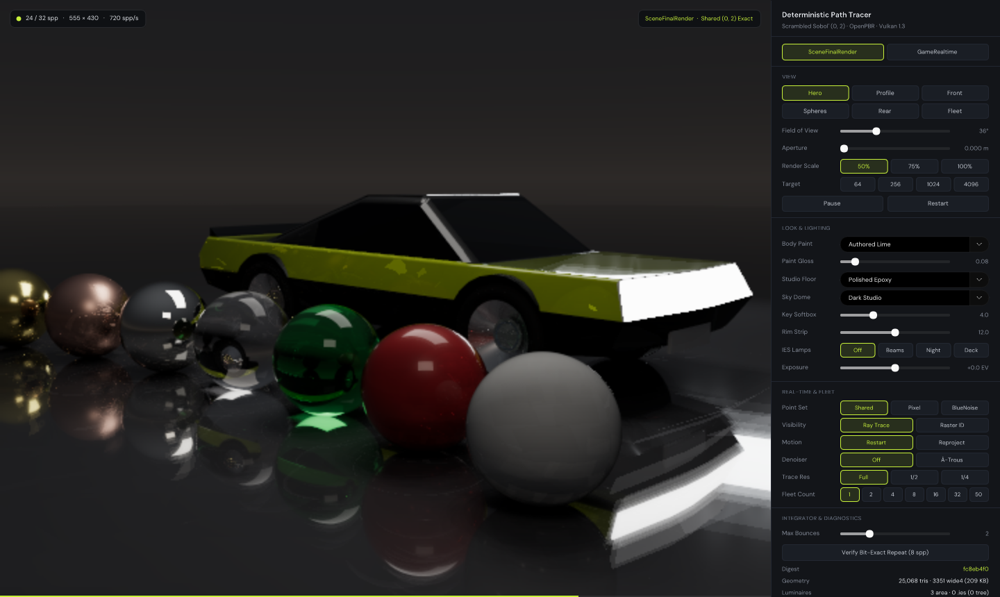 | 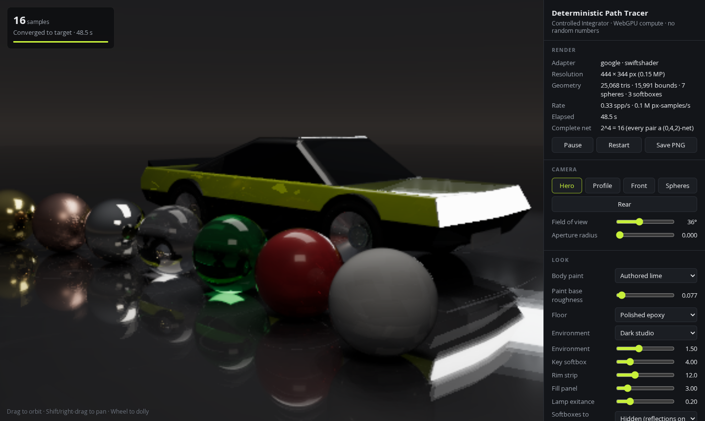 |
| **Native Vulkan 1.3 `SceneFinalRender` (`02-Hero_SceneFinalRender.png`)** | **HTML/WebGPU Reference (`HtmlReference/Hero_Authored_128spp.png`)** |
| 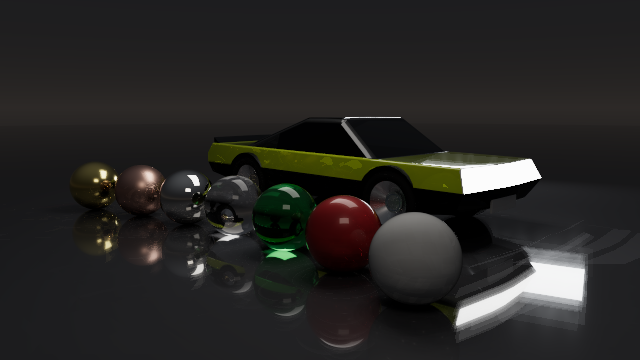 |  |
| **Native `1.25M`-Tri Fleet Daylight (`03-Fleet50_Daylight.png`)** | **HTML/WebGPU Reference (`HtmlReference/Fleet_50Vehicles_16spp.png`)** |
|  | 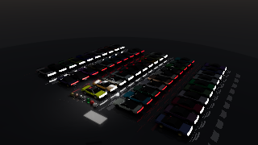 |
| **Native `228`-Lamp `.ies` Light Tree Night (`04-Fleet50_NightIes228.png`)** | **HTML/WebGPU Reference (`HtmlReference/Lamps_Night_Fleet50_64spp.png`)** |
| 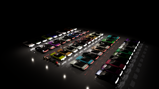 |  |

#### `GameRealtime` `1-spp` Reconstruction Strip (`05-ReconstructionComparison_GameRealtime.png` — Left: `1 spp` Noisy · Center: `1 spp` Blue-Noise + À-Trous · Right: `32 spp` Converged)

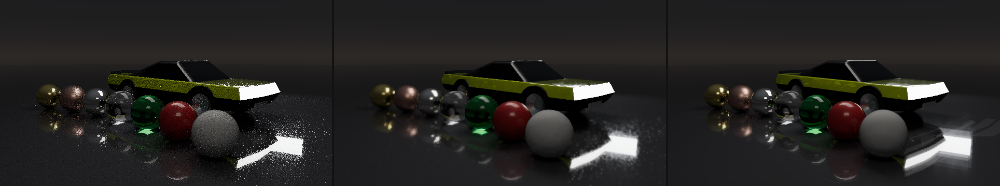
