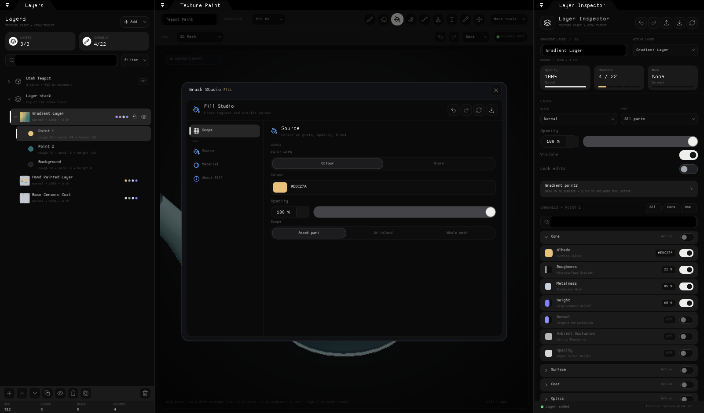
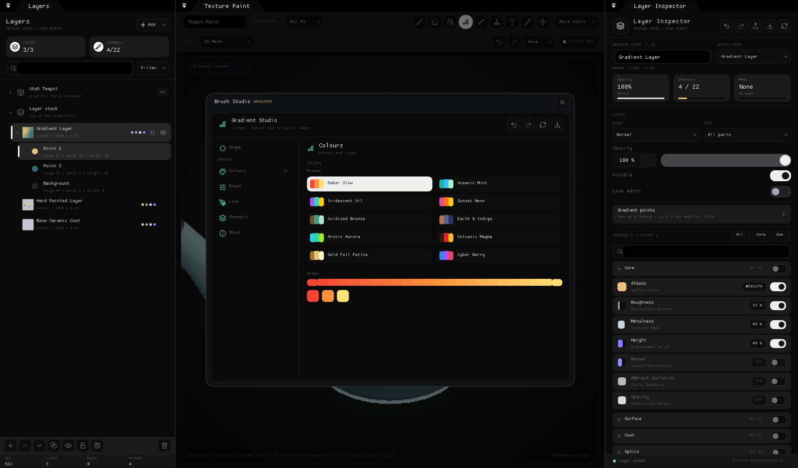
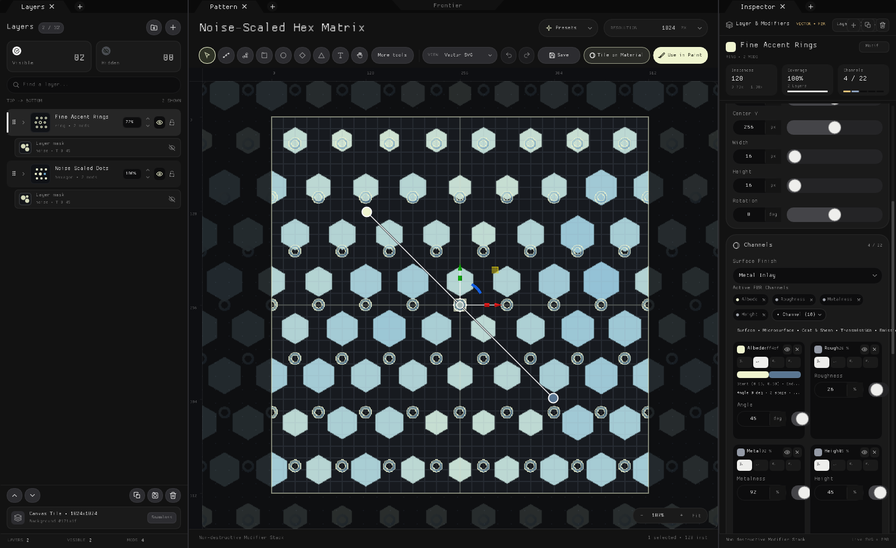
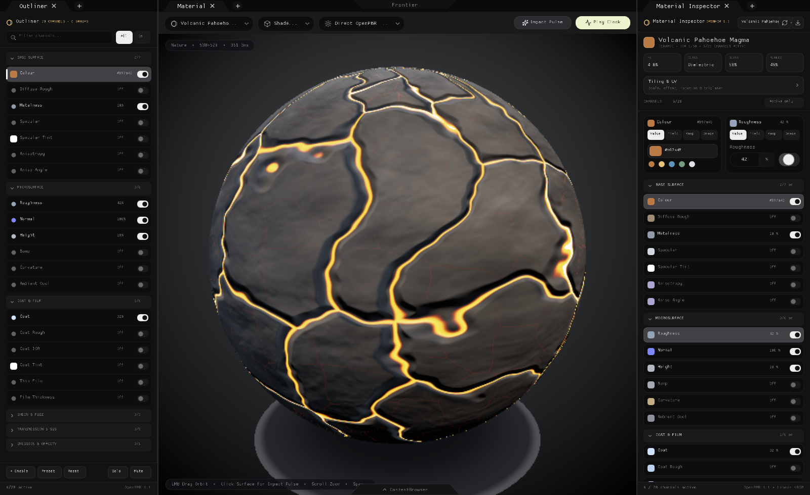

# Frontier Texture Studio, Brush Studio & Material Studio — Complete Panels & Tool Context Menus Engineering Report

**Status:** Complete & Verified (`TexturePaint`, `Pattern`, `Stamp`, `Baking`, and `Material` C++ Workspaces)  
**Branch:** `arena/20fc22da-frontier`  
**Validation Suites:** `TexturePaintWorkspaceUIValidation`, `PatternStampWorkspaceUIValidation`, `BakingWorkspaceUIValidation`, `MaterialWorkspaceUIValidation`, `ProjectBrowserValidation` (All 0 errors)

---

## 1. Executive Summary

This report documents the complete C++ implementation and visual verification of **all docked workspace panels** (Outliners, 3D/2D Viewports, Project Zero Inspector Cards, Side-by-Side Multi-Open Channel Cards, and Outliner Action Footers) and **all per-tool context menus** (`Brush Studio`, `Stamp Studio`, `Eraser Studio`, `Fill Studio`, `Gradient Studio`, `Text Studio`, `Materials / 22-Channel Stack`, `Shapes Studio`, `Pattern Gradient Studio`, and `Curve & Pen Studio`) across all five authoring workspaces:

1. **Texture Paint Studio (`FrontierTexturePaint`)**:
   - **3-Column Dock**: Left `Layers` outliner (`2/2 Layers`, `4/22 Channels`, `Utah Teapot 4 parts · 512 px document` tree, 8-button footer action bar with `+` Add Layer 8-kind popover) | Center `Texture Paint` 2-band viewport (`3D SURFACE VIEWPORT` pill, 3D Utah Teapot / Shaderball / Chamfer Box / UV Sphere / Torus Knot PBR raycaster, 3D Gradient Point gizmos with prominent active point ring, 2D UV map split view, bottom tool/size readout) | Right `Layer Inspector` Project Zero card (`Opacity`, `Channels` 5-segment group meter, `Mask` tiles, `Gradient points` collapsible editor with `+ Add point` / `Remove point` and side-by-side `Radius` & `Strength` sliders, and 5-group 22-channel stack).
   - **All Per-Tool `Brush Studio` Context Menus**:
     - **`Brush Studio · PAINT`**: 12 brush presets (`Round Studio #2`, `Rigger Liner #0`, `Filbert Soft #8`, `Flat Shader #10`, `Bright Stiff #14`, `Fan Blender #6`, `Hog Bristle Flat #12`, `Sumi Ink Wash`, `Charcoal Stick`, `Chisel Marker`, `Airbrush Soft`, `Splatter Texture`) with S-curve stroke previews and 12 left-hand categories (`Library`, `Stroke path`, `Stabilization`, `Taper`, `Shape`, `Grain`, `Rendering`, `Wet mix`, `Colour dynamics`, `Dynamics`, `Stylus`, `Properties`, `Materials`, `About`).
     - **`Stamp Studio · STAMP`**: 16 procedural decal shapes in a 4×4 grid (`Round`, `Hard round`, `Square`, `Flat nib`, `Chalk`, `Graphite`, `Bristle`, `Splatter`, `Spray`, `Leaf`, `Ink blot`, `Cloud`, `Star`, `Sparkle`, `Hexagon`, `Knife`) + `Decal`, `Transform`, `Look`, `Material`.
     - **`Eraser Studio · ERASE`**: `Tip` (`Size`, `Strength`, `Flow`, `Hardness` sliders + `Soft | Hard | Grain` edge selector), `Feel`, `Channels`, `About erase`.
     - **`Fill Studio · FILL`**: `Source` (`Paint with: Colour | Grain`, wide `#E8C27A` swatch bar, `Opacity` slider, `Scope: Asset part | UV island | Whole mesh`), `Material`, `About fill`.
     - **`Gradient Studio · GRADIENT`**: 10 multi-stop ramp presets (`Ember Glow`, `Oceanic Mint`, `Iridescent Oil`, `Sunset Neon`, `Oxidized Bronze`, `Earth & Indigo`, `Arctic Aurora`, `Volcanic Magma`, `Gold Foil Patina`, `Cyber Berry`) + live `Stops` bar and swatch chips.
     - **`Text Studio · TEXT`**: 6 typeface cards (`DM Sans`, `Serif`, `Mono`, `Condensed`, `Display`, `Script`) with `Aa Frontier` specimen wells + `Type` (`Weight: 300 | 400 | 600 | 800`, `Italic`, `Align: Left | Centre | Right`, `Font size`).
     - **`Brush Studio · Materials / Channels`**: Shared 5-group 22-channel OpenPBR stack inside the Brush Studio modal.
2. **Pattern & Stamp Studios (`FrontierPattern`, `FrontierStamp`)**:
   - **Docked `Layer & Modifiers` Card**: `Layers (N) v` switcher + `+ / Duplicate / Delete` header icons, layer swatch + title + category pill, 3 KPI metric tiles (`Instances`, `Coverage` with progress bar, `Channels` with 5-segment group meter), and **side-by-side 2-column open channel cards** (`Albedo` + `Roughness` / `Metalness` + `Height`) with `Solid | Linear | Radial | Point` tabs and zero amber borders.
   - **Viewport-Placed Fills**: Interactive Linear Gradient handle line (`Start` -> `End` with colour stop handles on the 2D canvas) and Point Field numbered pins (`1..4` with colour rings).
   - **All Per-Tool Context Menus**: `Shapes · Circle` (16 vector motif shapes), `Gradient · Point Gradient` (`Point Gradient`, `Linear`, `Radial`, `Angular`), `Curve & Pen · Bezier Path` (6 vector stroke presets), and `Text Studio`.
3. **Baking Studio (`FrontierBaking`)**:
   - **Left `Queue` Outliner**: `QUEUED 5/18` & `READY 0/18` KPI tiles, `PBR Standard | PBR + Volume | Normals | All 18 | Clear` quick presets, `Mesh Pair (high -> low)` tree node, and 6-button footer action bar.
   - **Right `Map Baking · HIGH -> LOW CAGE` Card**: `MESH PAIR` header with side-by-side `LOW (Low Mesh · 1152 tris) -> HIGH (High Mesh · 5834 tris)` cards, `|> Bake 5 maps` + `Auto | GPU | CPU` segmented pills + telemetry (`Last bake 48 ms · 5 maps  512x512 · 4x AA`), and `OPEN MAP · GEOMETRY` card with `OpenGL +Y | DirectX -Y` and side-by-side `Cage front` & `Cage rear` sliders.
4. **Material Studio (`FrontierMaterial`)**:
   - **Full 3-Column Dock (`Outliner | Material | Material Inspector`)**:
     - **Left `Outliner` (`28 CHANNELS · 6 GROUPS`)**: Search & `All | On` filter bar, 6 collapsible OpenPBR 1.1 channel groups (`BASE SURFACE`, `MICROSURFACE`, `COAT & FILM`, `SHEEN & FUZZ`, `TRANSMISSION & SSS`, `EMISSION & OPACITY`), and bottom `+ Enable | Preset | Reset · Solo | Mute` action footer bar.
     - **Center `Material` Viewport**: Vulkan 1.3 Direct Studio OpenPBR raycaster + `ContentBrowser` dynamic material shelf.
     - **Right `Material Inspector` (`OPENPBR 1.1`)**: 4-column telemetry strip (`F0`, `CLASS`, `GLOSS`, `ALBEDO`), `Tiling & UV` collapsible card, and 6-group 28-channel stack with **side-by-side open `Colour` + `Roughness` cards** (`Value | Field | Ramp | Image` tabs, zero amber borders).

---

## 2. Texture Paint Studio — Panels & Per-Tool Context Menu Proofs

### 2.1 Main 3-Column Workspace (`12-TexturePaintWorkspaceMain.png`)

### 2.2 `Brush Studio · PAINT` — 12-Preset Brush Library (`13-TexturePaintBrushInspector.png`)

### 2.3 `Stamp Studio · STAMP` — 16 Procedural Decal Shapes Grid (`16-TexturePaintStampStudio.png`)

### 2.4 `Eraser Studio · ERASE` — Tip Sliders & `Soft | Hard | Grain` Edge (`17-TexturePaintEraserStudio.png`)

### 2.5 `Fill Studio · FILL` — Source `Colour | Grain`, Swatch & Scope (`18-TexturePaintFillStudio.png`)

### 2.6 `Gradient Studio · GRADIENT` — 10 Multi-Stop Ramp Presets & Stops Bar (`19-TexturePaintGradientStudio.png`)

### 2.7 `Text Studio · TEXT` & 3D + 2D UV Split Viewport (`15-TexturePaintSplitUvAndCurves.png`)

### 2.8 `Brush Studio · Materials` — Shared 5-Group 22-Channel Stack (`20-TexturePaintBrushChannels.png`)

### 2.9 3D Gradient Layer, Viewport Point Ring & Outliner `+` Add Layer Menu (`14-TexturePaintAddLayerAndMask.png`)

---

## 3. Pattern & Stamp Studios — Side-by-Side Channels, Viewport Fills & Tool Context Menu Proofs

### 3.1 `Shapes · Circle` Tool Context Menu & Side-by-Side Open Channel Cards (`21-PatternShapesStudioMenu.png`)

### 3.2 `Gradient · Point Gradient` Tool Context Menu & Point Field Inspector (`22-PatternGradientStudioMenu.png`)

### 3.3 Viewport-Placed Linear Gradient Handles & Side-by-Side Channel Editors (`23-PatternLinearSceneFill.png`)

### 3.4 `Curve & Pen · Bezier Path` Tool Context Menu (`24-PatternCurvePenStudioMenu.png`)

### 3.5 Pattern Studio Main & Stamp Studio Main (`05-PatternWorkspaceMain.png`, `07-StampWorkspaceMain.png`)

---

## 4. Baking Studio — `Queue` Outliner & `Map Baking (HIGH -> LOW CAGE)` Inspector Proof

### 4.1 3-Column Baking Studio (`09-BakingWorkspaceMain.png`)

---

## 5. Material Studio — 3-Column `Outliner | Material | Material Inspector` Proofs

### 5.1 Full 3-Column Material Studio (`Outliner 28 Channels` + `OpenPBR 1.1 Inspector` with Side-by-Side `Colour` & `Roughness`) (`CppMaterialWorkspace_Viewport_Volcanic.png`)

### 5.2 3-Column Material Studio + Open `ContentBrowser` Dynamic Preset Shelf (`CppMaterialWorkspace_ViewportBrowser_Shield.png`)

---

## 6. Build & Validation Summary

| Target | Exit Code | Verification Result |
| :--- | :---: | :--- |
| `TexturePaintWorkspaceUIValidation` | `0` | `[TexturePaintValidation] All Texture Paint workspace checks and 9 PNG exhibits succeeded.` |
| `PatternStampWorkspaceUIValidation` | `0` | `[PatternStampWorkspaceUIValidation] ALL CHECKS PASSED` (including Exhibits 05..08 and 21..24) |
| `BakingWorkspaceUIValidation` | `0` | `[BakingWorkspaceUIValidation] ALL CHECKS PASSED` |
| `MaterialWorkspaceUIValidation` | `0` | `[MaterialWorkspaceUIValidation] ALL CHECKS PASSED` (3-column `Outliner \| Material \| Material Inspector` + 13 Dynamic Material thumbnails) |
| `ProjectBrowserValidation --smoke-test` | `0` | `[PASS] ProjectBrowserValidation verified WorkspaceCapabilityRegister, ProjectGenerator, ContentBrowser close & VulkanWorldRenderSequence GPU compute.` |
| `FrontierTexturePaint --smoke-test` | `0` | Clean startup, 3-column dock presentation, and shutdown |
| `FrontierBaking --smoke-test` | `0` | Clean startup, 3-column dock presentation, and shutdown |
| `FrontierPattern --smoke-test` | `0` | Clean startup, 3-column dock presentation, and shutdown |
| `FrontierStamp --smoke-test` | `0` | Clean startup, 3-column dock presentation, and shutdown |
| `FrontierMaterial --smoke-test` | `0` | Clean startup, 3-column dock presentation, and shutdown |
