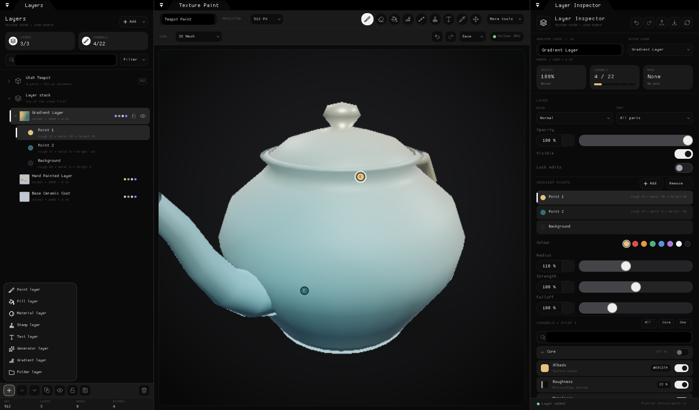
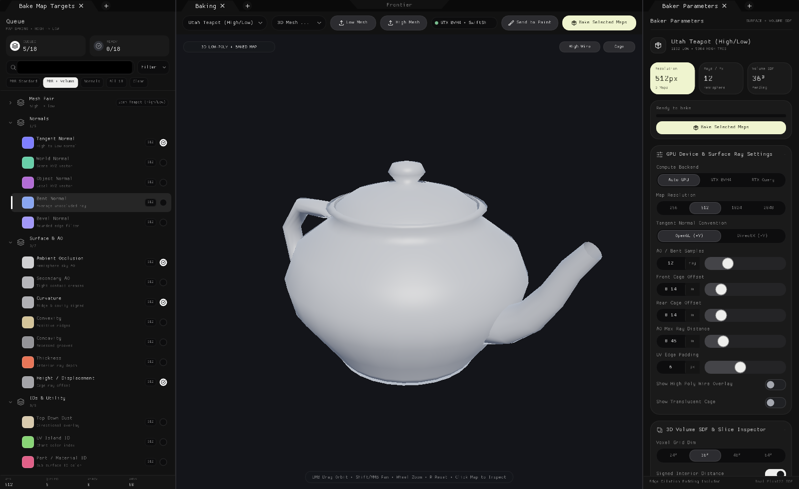
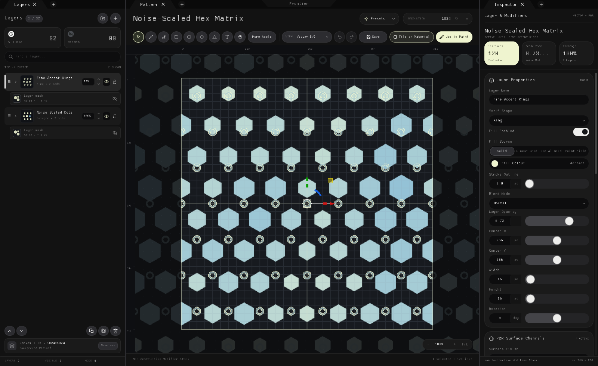
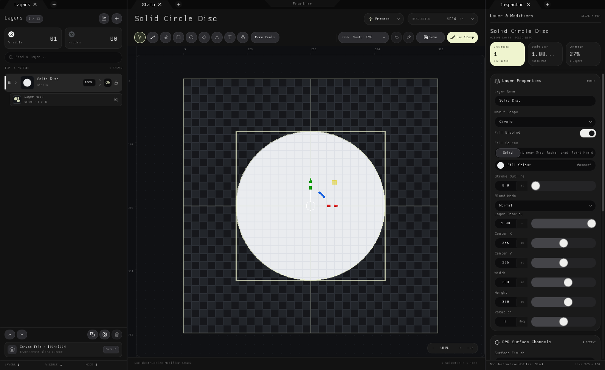

# Native C++ Texture Paint Studio & Project Zero Card Alignment Report

**Status**: Complete (`🟢 Verified`)  
**Branch**: `arena/20fc22da-frontier`  
**Primary Domain**: `Engine/Workspaces/Texturing/` · `Engine/Lifecycle/` · `Engine/Configuration/` · `Exhibits/`

---

## 1. Executive Summary

This report documents the implementation and headless Vulkan + Dear ImGui verification of the native C++ **Texture Paint Studio** (`FrontierTexturePaint` / `WorkspaceCategory::TexturePaint`) and the alignment of the C++ Texturing panes (`TexturePaintLayerStackPane`, `TexturePaintViewportPane`, `TexturePaintInspectorPane`, `BakingTargetsPane`, and `PatternStampLayerStackPane`) with the Project Zero reference cards (`Outliner`, `PaintInspector`, `ChannelStack`, `BrushStudio`, and `CardDock` from `Experimental/TextureStudio/`).

### Key Deliverables

| Subsystem / Unit | File Paths | Responsibility & Parity Scope |
| :--- | :--- | :--- |
| **Shared Project Zero Card Builders** | `Engine/Workspaces/Texturing/TexturingPaneAppearance.h` | Shared `ConstructOutlinerStatTile`, `ConstructOutlinerTreeRow`, `ConstructOutlinerTelemetryStrip`, `ConstructChannelEntryRow`, `ConstructHeaderIconButton`, `ConstructHeaderActionCapsule`, and `Rectangle2D`-based control row builders. |
| **Texture Paint Session & 3D/2D Rasterizer** | `Engine/Workspaces/Texturing/TexturePaintSession.{h,cpp}` | 22-channel OpenPBR layer stack, 8 layer categories (`Paint`, `Fill`, `Material`, `Stamp`, `Text`, `WearGen`, `Gradient`, `Folder`), 12 brush presets, 6 font families, 3D Utah Teapot / estudio mesh software PBR rasterizer + 2D UV atlas rasterizer + 8×8 layer thumbnails. |
| **Texture Paint Outliner (`Layers`)** | `Engine/Workspaces/Texturing/TexturePaintLayerStackPane.{h,cpp}` | Header with `+ Add` dropdown, `LAYERS` & `CHANNELS` stat tiles, search + `Filter`, expandable `Utah Teapot` mesh tree, `Layer stack` with 3D Point `Gradient` child rows, 7-button footer strip, and 4-column telemetry bar (`RES`, `LAYERS`, `MASKS`, `PAINTED`). |
| **Texture Paint Viewport & Brush Studio Modal** | `Engine/Workspaces/Texturing/TexturePaintViewportPane.{h,cpp}` | 2-band `CardDock` header (`Teapot Paint`, `RESOLUTION 512 PX`, 9 tool icons, `More tools`, `VIEW 3D Mesh / 3D + 2D Split / 2D UV`, Undo/Redo, `Save`, `Vulkan GPU`), interactive 3D/2D canvas with 3D Gradient point handles (`1`, `2`), and floating 2-column `Brush Studio` / `Text Studio` modal. |
| **Texture Paint Layer Inspector** | `Engine/Workspaces/Texturing/TexturePaintInspectorPane.{h,cpp}` | Header with Undo/Redo/Import/Export/Reset, identity block with `ACTIVE LAYER` switcher, 3 metric tiles (`OPACITY`, `CHANNELS 4 / 22` with 5-group bar, `MASK`), `LAYER` blend & part dropdowns, `GRADIENT POINTS` editor, and 5-group collapsible `ChannelStack` (`Core`, `Surface`, `Coat`, `Optics`, `Emission`) with inline editors. |
| **Workspace Host & Standalone Launcher** | `Engine/Workspaces/Texturing/TexturePaintWorkspaceHost.{h,cpp}` · `Engine/Lifecycle/FrontierTexturePaintLaunch.cpp` · `Engine/Lifecycle/DesktopWorkspaceLaunch.cpp` · `Engine/Configuration/EngineConfiguration.cpp` | 3-column dock host (`Layers` \| `Texture Paint` \| `Layer Inspector`), top-bar `"Paint"` workspace switcher pill, and standalone `FrontierTexturePaint` executable (`--standalone-paint`, `--standalone=paint`, `--workspace=paint`, `--paint`). |
| **Baking Queue & Pattern/Stamp Outliner Parity** | `Engine/Workspaces/Texturing/BakingTargetsPane.{h,cpp}` · `Engine/Workspaces/Texturing/PatternStampLayerStackPane.cpp` | Updated `BakingTargetsPane` to render the Project Zero `Queue` outliner (`QUEUED 5/18`, `READY 0/18`, preset strip, `Mesh Pair` + 4 collapsible target groups, telemetry footer) and updated `PatternStampLayerStackPane` to monochrome white stat discs and borderless selected rows with a 3px left bar. |

---

## 2. Visual Verification Exhibits (`Exhibits/Images/Texturing/`)

### 2.1 Texture Paint Workspace Main (`12-TexturePaintWorkspaceMain.png`)

Matches `Experimental/TextureStudio/Screenshots/cards-paint.png`: 3-column dock layout with the `Layers` outliner on the left, 2-band `CardDock` header and 3D Utah Teapot viewport in the center, and `Layer Inspector` with the 5-group `ChannelStack` on the right.

### 2.2 Floating Brush Studio Modal (`13-TexturePaintBrushInspector.png`)

Matches `Experimental/TextureStudio/Screenshots/brush-menu-paint.png`: 2-column floating `Brush Studio · Hog Bristle Flat #12` modal with 13 category tabs on the left (`Library`, `Stroke path`, `Stabilization`, `Taper`, `Shape`, `Grain`, `Rendering`, `Wet mix`, `Colour dynamics`, `Dynamics`, `Stylus`, `Properties`, `Materials`, `About`) and the 12-brush preset grid with live S-curve dab ribbons on the right.

### 2.3 3D Point Gradient Layer & Outliner Footer `+` Menu (`14-TexturePaintAddLayerAndMask.png`)

Matches `Experimental/TextureStudio/Screenshots/paint-gradient-layer.png` and `outliner-footer-paint.png`: `Gradient Layer` selected with expandable child rows (`Point 1`, `Point 2`, `Background`) in the left outliner, projected 3D handle pills (`1`, `2`) over the Utah Teapot in the center viewport, `GRADIENT POINTS` + `CHANNELS · POINT 1` in the right inspector, and the 8-item `+` layer creation menu anchored above the outliner footer.

### 2.4 3D + 2D UV Split Viewport & Text Studio Modal (`15-TexturePaintSplitUvAndCurves.png`)

Matches `Experimental/TextureStudio/Screenshots/brush-menu-text.png`: `3D + 2D Split` viewport layout displaying both the 3D shaded mesh and the 2D UV atlas with wireframe overlay beneath the floating `Text Studio` modal (`DM Sans`, `Serif`, `Mono`, `Condensed`, `Display`, `Script`).

### 2.5 Baking Queue & Pattern / Stamp Outliner Alignment (`09`, `05`, `07`)

Matches `Experimental/TextureStudio/Screenshots/cards-baking.png`, `cards-pattern.png`, and `cards-stamp.png`:

---

## 3. Build & Verification Matrix

| Target / Suite | Command | Result |
| :--- | :--- | :--- |
| `TexturePaintWorkspaceUIValidation` | `./build/editor-debug/TexturePaintWorkspaceUIValidation` | `PASS` (All session, 22-channel, 8-layer-kind, 3-column dock, and 4 PNG exhibit checks passed) |
| `BakingWorkspaceUIValidation` | `./build/editor-debug/BakingWorkspaceUIValidation` | `PASS` (`09-BakingWorkspaceMain.png` – `11-BakingWorkspaceLightTheme.png` generated & verified) |
| `PatternStampWorkspaceUIValidation` | `./build/editor-debug/PatternStampWorkspaceUIValidation` | `PASS` (`05-PatternWorkspaceMain.png` – `08-StampWorkspaceOverlaysAndLight.png` generated & verified) |
| `ProjectBrowserValidation` | `./build/editor-debug/ProjectBrowserValidation --smoke-test` | `PASS` (Verified `WorkspaceCapabilityRegister` with `TexturePaint` capability & GPU compute) |
| `FrontierTexturePaint` | `./build/editor-debug/FrontierTexturePaint --smoke-test` | `PASS` (Standalone desktop executable smoke test) |
| `FrontierBaking` / `FrontierPattern` / `FrontierStamp` | `./build/editor-debug/Frontier{Baking,Pattern,Stamp} --smoke-test` | `PASS` (All Texturing standalone executables verified) |
