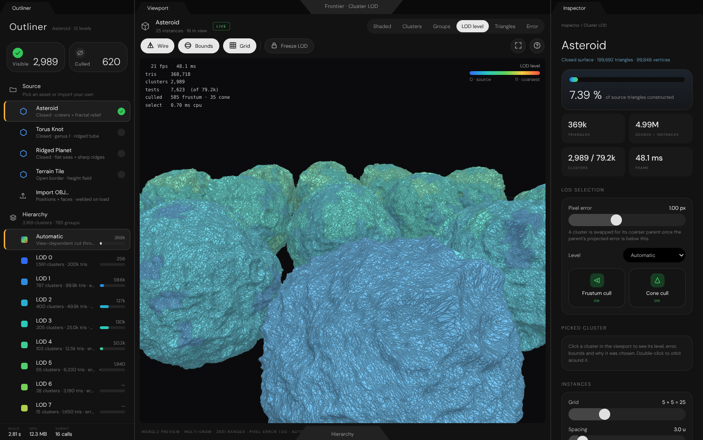

# Cluster LOD Studio (`Experimental/ClusterLodStudio`)

> A Nanite-style cluster hierarchy with view-dependent LOD selection, built from scratch in plain JavaScript and
> rasterised with WebGL2. No dependencies, no build step. UI follows `Experimental/ProjectZeroEditor`
> (Outliner · Viewport · Inspector docks, trapezoid tabs, top notch, bottom drawer).



## Run

```bash
python3 Experimental/ClusterLodStudio/Serve.py 8093      # then open http://localhost:8093/
node Experimental/ClusterLodStudio/Scripts/CheckClusterHierarchy.mjs
```

URL parameters for repeatable captures: `?preset=asteroid|knot|planet|terrain&budget=200000&side=5&mode=levels&error=1&wire&drawer`.

## How it works

| Step | File | What happens |
| :--- | :--- | :--- |
| Source | `Engine/SourceGeometry.js` | Welded procedural assets (asteroid, torus knot, planet, open terrain) or an imported OBJ (positions + faces, welded by position). |
| Cluster | `Engine/ClusterHierarchy.js` | Triangles are split into clusters of ≤ 128 by median bisection of centroids. |
| Group | `Engine/ClusterHierarchy.js` | ~4 neighbouring clusters are grouped by greedily maximising shared border edges. |
| Simplify | `Engine/QuadricSimplification.js` | The group's outer border is locked; the interior is reduced to ~50 % by quadric edge collapse onto existing vertices. |
| Recurse | `Engine/ClusterHierarchy.js` | The result is split into new clusters (next level) until one cluster remains or simplification stalls. |
| Select | `Engine/ClusterSelection.js` | Per frame, per instance: walk the DAG from the roots; construct a cluster when its own projected error ≤ threshold and its parent's is above it. Frustum culling (hierarchical) and normal-cone culling run in the same walk. |
| Rasterise | `Engine/ViewportRasterization.js` | One static corner stream for all levels; selected ranges go out through `WEBGL_multi_draw` (range loop fallback). Positions are pulled from a float texture, so every level shares one vertex set. |

Why cuts are crack-free: every group stores one `(error, sphere)` pair that is the *own* error of the clusters built
from it and the *parent* error of the clusters it consumed, so both sides of a group border always decide the same way;
border vertices are locked, so any mix of levels meets exactly. Error is forced monotone and spheres nested up the DAG.

## Controls

| Input | Effect |
| :--- | :--- |
| Drag · Right-drag / Shift-drag · Wheel / pinch | Orbit · Pan · Zoom |
| `W A S D` `Q E` (+ Shift) | Fly |
| Click · Double-click | Pick a cluster into the Inspector · Orbit around it |
| `1`–`6` | Shaded · Clusters · Groups · LOD level · Triangles · Error |
| `[` `]` | Pixel error threshold |
| `L` | Freeze LOD + culling at the current camera, then fly out to inspect the cut and the frustum |
| `Z` `B` `G` `C` | Wireframe · Picked bounds · Grid · Cone culling |
| `F` · `Esc` | Frame everything · Clear pick |

Inspector: pixel error, forced level, culling toggles, instance grid, build parameters (cluster size, group size,
keep ratio, source density), and for the picked cluster its level, triangle count, own/parent error in units and
pixels, and the sentence explaining why it was chosen. The bottom **Hierarchy** drawer charts stored vs. constructed
triangles per level and frame time.

## Validation

`Scripts/CheckClusterHierarchy.mjs` builds every preset and asserts: cluster size limit, monotone error, nested
spheres, every level watertight, and for 60 random cameras per asset that the DAG walk equals a brute-force oracle and
the resulting cut is watertight (no open edges, no edges with 3+ triangles). It also covers OBJ welding and a deep
hierarchy with small clusters.

## Limits (stated plainly)

- Error is a quadric RMS-distance estimate in object units, not a certified Hausdorff bound.
- Simplification is position-only: no UV / normal seams, no attribute error. Coarse levels reuse source vertex normals.
- Clusters come from spatial bisection, not graph partitioning (METIS), so a cluster can be disconnected on thin or
  folded shapes. Correctness does not depend on it; cluster quality does.
- No occlusion culling (HZB), no streaming, no software / compute rasteriser, no visibility buffer. Selection runs on
  the CPU; WebGPU is not used.
- Picking supports up to 254 instances (the grid tops out at 15 × 15).

Fonts: DM Sans, SIL Open Font License (`Fonts/OFL.txt`).
