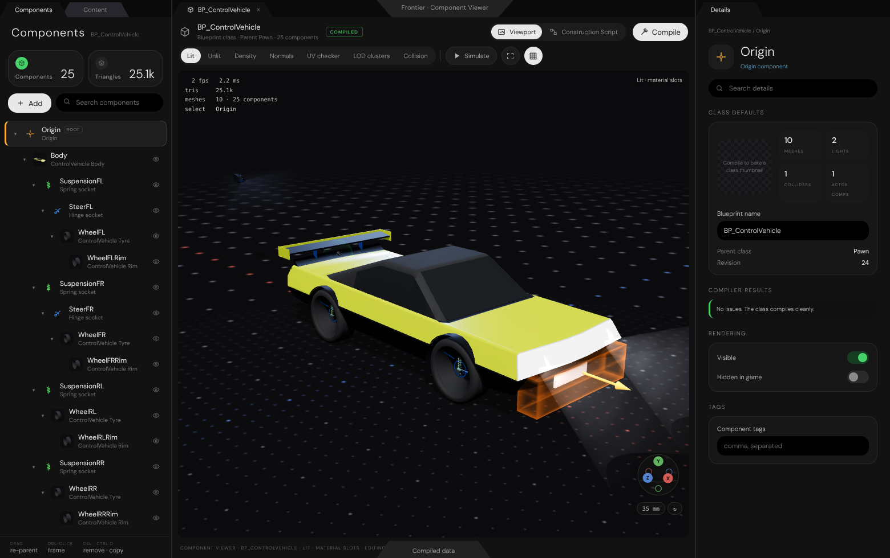

# Component Viewer

Vehicle Lab, renamed and redesigned as a Blueprint-style **Component Viewer**, merged with Frontier-1's Cluster LOD
Studio (Hero Workspace) as an import step called **Geometry Compile**. The look follows Project Zero as Cluster LOD
Studio uses it: charcoal docks on a 2 px seam, trapezoid tabs, pill sliders, white active segments, amber selection,
a notch at the top for shortcuts and a drawer at the bottom.

```
python3 Experimental/ComponentViewer/Serve.py        # http://0.0.0.0:8095/ → /Experimental/ComponentViewer/
```

🧩 **Two workspaces (M0 split, 2026-11-15).** Geometry Compile is now its own page,
[`Experimental/GeometryCompiler/Compile.html`](../GeometryCompiler/Compile.html) (8095 serves it too). Imports, samples
and **Recompile** open it in a full-window frame; it hands the compiled asset back through
[`Shared/GeometryCompile/CompileExchange.js`](../Shared/GeometryCompile/CompileExchange.js) (structured-clone messages,
mirrors `CompiledGeometryExchange` in the C++ plan). Opened directly, the compiler runs standalone with its own start
screen. Code both pages use lives in `Experimental/Shared/` (table below).

## Screenshots



## Two screens

**Geometry Compile** (the import inspector) opens for every imported object: OBJ, glTF / GLB, STL, PLY and Frontier's
FCT1 `.facet`. FBX is listed but has no reader yet. Steps run top to bottom, and changing a setting marks that step
and every step after it stale:

| Step | What it does | Runs |
|---|---|---|
| Source & Units | Reads the file, sets units (m/cm/mm/in/ft) and Z-up → Y-up, welds with a tolerance, checks topology | auto |
| Geometry | Scale, mirror, rotate, pivot (centre, floor or authored), flip normals, normals mode (smooth/flat/angle split) | auto |
| UV Charts | Chart unwrap and pack (from Frontier-1), checker / chart preview, OBJ + UVs and SVG sheet export | Bake |
| SDF Bake | Signed distance field in a worker, slice view and raymarched preview, `.r32` export | Bake |
| Cluster LOD | Nanite-style cluster hierarchy in a worker, levels with triangle counts, error and wrong-material share; **Preserve materials** toggle (below) | Bake |
| Collision | Box, sphere or capsule fit, the SDF as a distance-field collider, or none | auto |
| Icon Bake | Content-browser icon inside a square capture frame, clay or normal shading, PNG export | auto |
| Metadata | Name, category and tags | auto |

**Compile & open** adds the compiled asset to Content and opens it as a new Blueprint class. Esc cancels.

### Material-aware cluster LOD

Every LOD triangle is a surviving source triangle, so it always keeps its material slot. Forced LODs and the
*Materials* preview draw each face with its own slot. With **Preserve materials** on (the default):

- Each material is clustered as if it were its own mesh, so every cluster holds one material.
- The simplifier holds the seams between materials, using the same machinery as open borders:
  - **Slide** (default): seam vertices may move only along the seam.
  - **Pin**: seam vertices never move, so borders stay exact and reduction stops earlier.
- Vertices where three or more materials meet never move, and no collapse may remove the last faces of a material
  in a group.
- It is still one mesh. Clusters on either side of a seam index the same shared vertices and edges, are grouped
  together across the seam and simplify together. Every level stays crack-free, and the check script verifies this
  with edge counts.

*Wrong material* is the share of a level's surface that shows a different material from the source surface nearest
to it.

| Mesh | Off | Slide | Pin |
|---|---|---|---|
| ControlVehicle body, LOD 2 | 2.6% at 726 tris | 0.02% at 744 tris | 0.3% at 884 tris |
| Torus, 8 material regions | 24% at 1254 tris | 0.9% at 1928 tris | 0.3% at 3984 tris |


**Component Viewer** (the Blueprint editor):

- *Components*: the scene hierarchy under the class's **Origin** (its own frame; renamed from the old default root). Drag a row onto another to re-parent it. Each row has a
  visibility toggle and a warning marker. Actor components (Vehicle Movement, Rotating Movement) sit in their own
  section. **Add** lists the component classes plus every compiled mesh in Content.
- *Viewport*: 7 inspection channels, keys 1–7: Lit, Unlit, Density, Normals, UV checker, Cluster LOD and Collision.
  Click a component to select it, or drop a Content asset onto the viewport to add it. **Construction Script** shows a
  generated node graph you can pan, zoom and drag.
- *Details*: built from each class's property specs (transform, mesh and material slots, LOD, lights, camera,
  collision, vehicle wheels and powertrain). Selecting the root shows class defaults, compiler results and the asset
  pipeline state.
- *Drawer*: compiled-data cards (icon, UV, SDF, LOD, collision) for the selected mesh, plus Vehicle Lab's torque curve,
  editable with linear, smooth, ease or step interpolation.
- *Simulate* (Space): Vehicle Lab's drive preview, with speed, rpm, acceleration, torque, gear, throttle and brake.
  It spins the Vehicle Movement wheels and Rotating Movement components.
- **Compile** (Ctrl+S) validates the class and bakes its icon. The other keys are Del, Ctrl+D, F, G, T, C and Esc; press
  ? for the full list.

**Sockets** (`Sockets.js` model, `SocketVisuals.js` looks). A socket is not a fixed point: its children ride on a
*joint frame* and the socket kind decides how that frame moves. Pick a kind from the tiles in Details (your numbers are
kept when you switch) or add one directly from **Add → Sockets**.

| Kind | Moves | Drives | Debug look |
|---|---|---|---|
| Fixed | never | — | Graphite hex puck, lit face, three bolts |
| Hinge | about one axis, between two angles | Hold at pose · Sweep | Pin and knuckles, a light fan over the allowed range with bright limit edges, a needle with a glowing tip at the current angle |
| Slider | along one axis, between two stops | Hold at pose · Sweep | Translucent track on a steel rail, ringed end stops, a glowing carriage |
| Ball | inside a cone | Hold at pose · Orbit | Ball in a cup, the allowed cone as a light volume, a stem with a glowing knob showing the current swing |
| Spring | along one axis, with stiffness and damping | Preload pose; reacts to acceleration (rear squats, front lifts) and road bumps met at each spring's own position | Coil that compresses live and brightens with speed, damper body and rod, plates |
| Spin | continuously | Fixed rpm · vehicle speed over a rolling radius | Hub and a ring of three comet arcs that turns with it, brighter with rpm |
| Tether | hangs on a length and swings (pendulum) | Gravity, drag, trails back under acceleration (atan a/g) | Eye, rope, end ring; when selected, a fan of the swing range |
| Dock | connects and disconnects | Hold (Connect / Release) · Pull test · Aero load from Vehicle Movement | Collar with state notches, an iris (steady when connected, rings pulling in when seeking, pushing out when rejected), the snap radius as a field, a flux beam to the plug while it is free, a ripple on connect |

- A dock only accepts children whose tags contain its **key** (empty key accepts anything). Wrong key: the plug is
  pulled to the snap radius and bounced, never connected, and the class reports it. Load colours the notches
  green → amber → red as it nears the break force; above it the dock releases.
- Connect, release and rejection events rise as pings from the socket. The selected socket shows a floating tag (kind,
  name, live value) and is drawn in an x-ray pass, so a spring inside a tyre stays visible.
- **Kick** (Spring, Tether) and **Reset motion** are in Details; the pose slider scrubs Hinge, Slider, Ball and Spring
  in the editor; Sweep, bumps, pull tests and vehicle-driven motion run in Simulate.

On BP_ControlVehicle every wheel hangs from a Spring socket at its axle mount, the front wheels turn on Hinge sockets
(±32°), Vehicle Lab's RearWingSocket is a Dock keyed `wing` holding a procedural rear wing (pull test: tears off at
1.2 kN and snaps back), and a TowStrap tether swings at the rear.

**Glide camera** (`Camera.js`, both viewports). State is a pivot plus yaw, pitch, distance and focal length; input
writes goals and the live values ease toward them, so nothing ever cuts.

- Drag orbits with inertia around the *surface you grabbed*: on press the pivot slides along the view axis to the depth
  under the cursor, so the view never jumps but always turns around what you touched.
- Wheel glides toward the point under the cursor. Right / middle / Shift drag pans. Hold right and use WASD + QE to
  drift (Shift for speed).
- Alt + wheel, or the lens chip (14 / 24 / 35 / 50 / 85 / 135 mm), is a dolly zoom: distance scales with focal length,
  so the subject keeps its size while the perspective flattens or deepens.
- F, double-click, step changes and new imports are eased flights (position, pivot and lens, log-space distance).
- The dial (bottom right) shows the axes as depth-sorted beads with a horizon arc; click a bead to fly to that side.
  ↻ is a turntable that pauses while you touch the view. With a Camera component selected, **Look through** (C) flies
  into its pose and lens.
- While simulating, speed opens the lens slightly and high rpm adds a faint engine shimmer.

**Debug visuals** (`Visuals.js`): no line helpers anywhere. Volumes are surfaces, light is light.

| Thing | Drawn as |
|---|---|
| Collision (compiled green, components amber) | Field shell: fresnel rim, soft face borders, rising scan bands |
| SDF collider | Shell with one soft dot per voxel cell on each face |
| Spot light, camera view | Additive light-volume beam (round / 16:9 four-sided) fading along its axis |
| Point light | Glow core; influence radius as a faint additive field while selected |
| Selection | The selected surfaces glow amber toward their silhouette, breathing slowly. The fresnel term is injected into the mesh's own material (a per-selection clone), so there is no second mesh and nothing on the floor |
| Camera component | Modelled cinema camera: rounded body, mount, knurled focus ring, coated front element, hood, handle, monitor (lit when selected), battery, tally lamp (glows when selected); the view beam starts at the lens |
| Origin / Scene pivots, Geometry-step pivot | Shaded anchor: ring, core and three axis beads |
| Arrow | Shaded shaft and cone |
| Floor | Dots (metres, quarters) fading out around the pivot; axis dots tinted red X / blue Z |
| Open borders (Source step) | Trail of glowing amber beads |
| Triangle density (replaces wireframe) | Heat ramp per triangle from its area against the median: blue sparse … red dense |
| Mesh with no asset | Pulsing red field box |

The starting class is **BP_ControlVehicle**, the Vehicle Lab car. Its body, tyre and rim `.facet` files are compiled
through the same pipeline. It has four wheels on Spring sockets (front ones on steering Hinges), each with a rim child, a docked rear wing, a tow strap, headlights, a chase camera, a bumper trigger and
Vehicle Movement, using the Vehicle Lab sheet values: 1300 kg, a 520 N·m peak and a 7200 rpm redline.

## Files

| File | Role |
|---|---|
| `Main.js` | Boot, compile context, import flow and Geometry Compiler hand-off, vehicle class |
| `ComponentViewer.js` | Blueprint editor UI |
| `Blueprint.js` | Component classes, property specs, tree operations, validation, torque curve, drive step (no DOM) |
| `Sockets.js` | Socket kinds, parameters, step (springs, pendulum, dock state machine), joint pose (no DOM) |
| `SocketVisuals.js` | One debug look per socket kind |
| `ComponentViewer.css` | Viewer-only styles (compile frame, simulate HUD, construction script, sockets) |
| **`../GeometryCompiler/`** | **Workspace 2:** `Compile.html`, `CompileMain.js` (standalone / framed boot), `GeometryCompile.js` (import inspector UI), `GeometryCompiler.css`, `Scripts/SmokeGeometryCompile.mjs` |
| `../Shared/GeometryCompile/CompileSteps.js` | Step pipeline, settings, invalidation (no DOM) |
| `../Shared/GeometryCompile/CompileContext.js` · `CompileSources.js` · `CompileExchange.js` | Workers + icon baker · file / preset / FCT1 sources · viewer ↔ compiler messages |
| `../Shared/GeometryCompile/Engine/` | Readers, mesh analysis, workers; SDF, UV, cluster LOD, simplification, transform and OBJ export from Frontier-1 |
| `../Shared/Studio/` | `Render.js` (three.js stage, channels, icon renderer), `Camera.js` (glide rig + HUD), `Visuals.js` (shader debug visuals), `Ui.js`, `Icons.js`, `Studio.css`, `Vendor/` (three.js r187), `Fonts/` (DM Sans, OFL), `Scripts/StudioHarness.mjs` (jsdom harness) |
| `../Shared/Models/` | ControlVehicle Body / Tyre / Rim (FCT1) from Vehicle Lab |

## Checks

```
node Experimental/ComponentViewer/Scripts/CheckComponentViewer.mjs          # readers, pipeline, blueprint model, drive
npm install --prefix /tmp/smoke jsdom@25
JSDOM_DIR=/tmp/smoke node Experimental/ComponentViewer/Scripts/SmokeComponentViewer.mjs   # UI paths in jsdom
JSDOM_DIR=/tmp/smoke node Experimental/GeometryCompiler/Scripts/SmokeGeometryCompile.mjs  # compiler page in jsdom
```

The viewer smoke plays the framed compiler with a stand-in that compiles headlessly and structured-clones the result,
so the hand-off is exercised end to end; the compiler smoke drives every step, Compile all, exports and the handshake.

The smoke test boots the whole page with mocked WebGL and workers, then clicks through every main path. It fails on any
runtime error. It does not check what the GPU draws.

Sources: Vehicle Lab is `Experimental Remastered/AssetInspector` on Frontier-OLD, branch `arena/d96da802-frontier`.
Cluster LOD Studio is `Experimental/ClusterLodStudio` on Frontier-1, branch `arena/453e172d-frontier-1`. Copied engine
files keep an attribution header.
