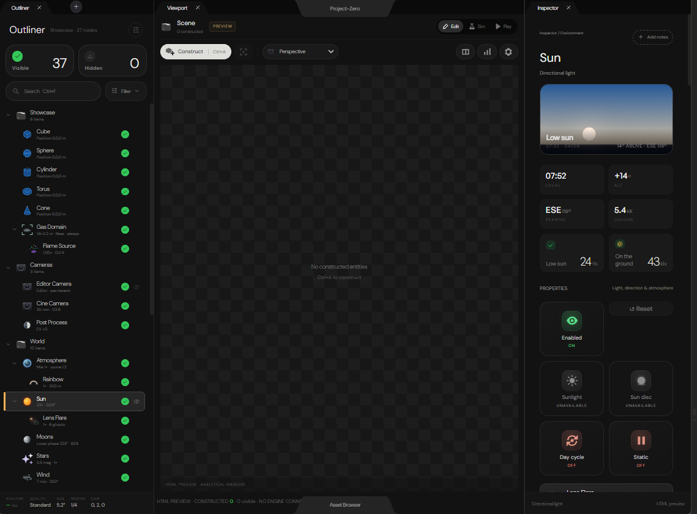

# 🧩 Project-Zero Editor UI (`Experimental/ProjectZeroEditor`)

> **TL;DR**: Canonical HTML/JS reference specification for the native C++20 shared UI components (`Engine/Components/` + `Engine/Workspaces/` + `Engine/Editor/`). Defines the trapezoidal dockable tab bars (`Outliner`, `Viewport`, `Inspector` + adjacent `+` tab button), top `Project-Zero` trapezoidal Notch, bottom `Asset Browser` trapezoidal drawer tab, Outliner entity cards, and shared Environment/Light/Material/Fog/Wind inspector cards.



---

## 🏷️ Key UI Surfaces & Shared Component Targets

| Surface in `ProjectZeroEditor` | Visual & Interactive Mechanics | Target Shared C++20 Unit |
| :--- | :--- | :--- |
| **Trapezoidal Dock Tabs** (`Outliner ×`, `Viewport ×`, `Inspector ×`, `+`) | Sloped side bevels, active bottom join into panel background, circular `×` close button, adjacent circular `+` button; dockable across any application window, tears off into an OS window when undocked, and restricts docking strictly within the application. | `Engine/Components/Docking/{TrapezoidalTabGeometry,DockingPanel}.{h,cpp}` |
| **Top Trapezoidal Notch & Bottom Drawer Tab** | Top-center pull-down `Project-Zero` Control Centre notch and bottom-center pull-up `Asset Browser` drawer handle. | `Engine/Components/Overlays/` & `Engine/Editor/Explorer/ContentBrowser` |
| **Scene Outliner** | `Visible` / `Hidden` summary counters, search/filter pills, collapsible collection hierarchy (`Showcase`, `Cameras`, `World`), per-classification SVG icons, and status toggles. | `Engine/Editor/Explorer/SceneOutliner.{h,cpp}` |
| **Property Inspector** | Hero preview banner (`Low sun` sky gradient), 2×2 metric readout cards (`07:52`, `+14°`, `ESE 118°`, `5.4 kK`), status tiles (`Enabled`, `Day cycle`), and shared scalar/color controls. | `Engine/Components/PropertyPanels/` & `Engine/Components/Controls/` |

---

## 🔍 Local Preview

```bash
python3 Experimental/ProjectZeroEditor/Serve.py 8097
```

---

## 📦 Provenance (this copy)

Copied unchanged (after the 2026-11-20 sync below) from `unassignedinbox/Frontier`, `Experimental/ProjectZeroEditor`, at branch `arena/ad7fa01c-frontier` commit `e4966e4`.
This folder was last synced there on 2026-11-20 (`718bdd2`), and every recent branch has the same copy (tree `f188f1d`). This is the UI-only build.
The integrated-render variant (`arena/f810ccd5-frontier`, with `Shader/`, `Source/` and `Tools/`) was deliberately not used. It is the
starting point for the UI redesign.

- `index.html` is the prebuilt, self-contained bundle (scripts, styles, icons and the shader ball are inlined). The only outside requests are three
  Fontshare web fonts (`InspectorDepot/Fontshare.css`). Without internet the page falls back to system fonts.
- Preview here: `python3 Experimental/ProjectZeroEditor/Serve.py 8097` (serves the repository root; `/` opens the editor).
- Rebuilding from the `.jsx` / `.js` sources:

  ```bash
  cd Experimental/ProjectZeroEditor
  npm install        # react, react-dom, esbuild (node_modules is git-ignored)
  node Build.mjs     # rewrites index.html
  ```

  `Inspectors.jsx` imports six files from `Experimental/FrontierEditor/` (copied from the same source branch). When any of the source assets
  (`EngineContent/Fonts/SunReference`, celestial textures, `VectorCodec.cpp`, `ShaderBall.mesh`) is missing, `Build.mjs` reuses the icons, fonts,
  moon textures and shader ball already embedded in `index.html`. Missing `../FractureEditor/*` imports fall back to a bridge plugin.

---

## Follow-up 48: 3D viewport, outliner multi-select and row menu, a rendered Sun card, Atmosphere limb with a height handle

- **3D viewport** (`Viewport3D.jsx`). It replaces the checkerboard as the main view. The **3D** button in the viewport toolbar switches
  to the marker view and back (`Settings.Viewport`, `"3d"` or `"markers"`, kept with the scene). It uses the Component Viewer's three.js
  renderer (`Shared/Studio/Render.js`), not SDF.
  - **Shapes**: every geometry object, with its size settings, Transform, base colour, roughness and metallic. The five Showcase
    shapes stand on a line 1.8 m apart, and Position moves an object from its place on that line.
  - **Sun**: direction from the Sun's date, time and place (or its manual direction). The colour is its temperature times the sunlight
    left after the air, so it reddens at sunset. It casts shadows.
  - **Atmosphere**: the sky-view map (`BakedMaps.js`, `SkyShader.js` in a 1024 × 512 equirectangular image, sun disc included), drawn as the scene background at
    infinity, so zooming can't clip it. Below the horizon the image continues the horizon colour, and the ground (which follows the
    camera out to just short of the far plane) fades into haze of that colour, so there is no edge or seam. Clouds are not drawn.
  - **Stars**: the Stars object's catalogue (`StarCatalogue`, 40,000 stars over the whole sphere with a real-sky magnitude spread) as a
    point field (`StarField`), sharp at any zoom, fading towards the horizon. Brightness, Point Size, Limiting magnitude and Star field
    apply; it turns about the celestial pole (at the Sun's latitude) by Celestial rotation plus 15° an hour, so stars rise in the east.
    It comes out as the sun goes from −4° to −14°. Twinkle is not drawn. At night the sky keeps a faint blue airglow and a moonlit fill
    light keeps the shapes readable.
  - **Lens Flare** (`LensFlare.js`): the Lens Flare object drawn over the view from its baked atlas, where the sun is on screen: glow,
    starburst (spikes from Aperture Blades), ray pairs, anamorphic streak, halo and ghosts on the line through the centre. Five rays
    test how much of the sun the shapes hide; it fades at the frame's edge and as the sun sets, and follows Enabled, Type, the layer
    switches and every slider. A screen-space illustration, not a lens simulation.
  - The camera stays above the ground. The dot grid shows only when looking down. Until you move the camera, the shapes are re-framed
    when the viewport changes shape.
  - Zoom stays between 0.6 m and 150 m. (Earlier the sky was an 800 m sphere that the camera rig's moving far plane cut away when
    zooming in, and the ground disc and fixed fog showed when zooming out.)
  - **Controls**: click to select, Ctrl or Shift click to add, drag to orbit, right or Shift drag to pan, wheel to zoom, F to focus.
  - It draws a frame only when the camera or the scene changed.
- **Outliner multi-select and row menu.**
  - Ctrl-click toggles a row; Shift-click takes the visible rows in between. The inspector shows the last row clicked.
  - The right-click menu acts on every chosen row: Rename (one row), Show / Hide, Isolate, Focus in viewport, Inspect in workspace,
    fracture on/off, Select children, Group into collection, Duplicate, Copy names, and **Delete** (also the Del key).
  - One delete can be undone with Ctrl+Z or the menu. Built-in collections and the editor camera can't be deleted.
- **Sun first card** (`SunCards.jsx`, replacing the F47 dial / horizon / sheet). It shows the real sky and sun for the current
  time and place, rendered from the Atmosphere's settings. Each framing shows only the time and one line, with a day bar underneath:
  - **A · Sky**: standing on the ground, facing the sun.
  - **B · Day**: a wide sky with the sun's path, plus sunrise and sunset on the horizon.
  - **C · Disc**: the sun itself at true size, white by day and orange when low.

  Drag the picture or the bar, or use the arrow keys, to move through the day.
- **Atmosphere first card** (`AtmosphereCards.jsx`). Design B (the planet's limb) is kept and redrawn per pixel by `SkyShader.js`:
  - It uses Rayleigh, Mie and ozone, with true colours instead of the old gradient.
  - The design switch, the three figure tiles and the swatches are gone. The picture fills the card.
  - A dashed outline marks the top of the air, and its handle sets **Atmosphere** height by dragging (10–120 km; arrows ±1 km, PgUp/PgDn ±10 km).
  - "Sun at the limb" moves the sun from −12° to 40°.
- **BAKING sections show the viewport's maps** (`BakedMaps.js`, cards in `BakedMapCards.jsx`). The viewport and an open inspector share
  one bake.
  - **Not baked yet**: the original bake tab (Use baked image, **Bake**, Load image) with the planned resolution and format.
  - **Baked**: the map on labelled axes, then Resolution, Format, Baked (time · ms · count), X and Y ranges and a Cursor readout (axis
    coordinates and colour under the pointer), with **Bake again** and **Save PNG**. A baked map bakes again by itself when its settings change.
  - **Atmosphere bake**: the transmittance LUT (256 × 64, view elevation −12° to 90° by altitude, the horizon and low air widened) and
    the sky-view map (the viewport's 1024 × 512 background).
  - **Sun lighting bake**: the lighting LUT (256 × 64 across sun elevations: the sun beam over the sky fill, with a marker at the sun now).
    **Sun disk bake**: the 192 × 192 disc map, the sun as the viewport draws it.
  - **Star field bake**: the 1024 × 512 star map in celestial coordinates.
  - **Lens flare image**: the 1024 × 512 flare atlas (glow, starburst, halo, streak, four ghost tints). The **Flare composite** card now
    draws with the viewport's flare code and this atlas.
  - Native bakes and the native dome image (Baked atmosphere card) still need the engine.
- **Editor assets** (`EditorAssets.js`): low-poly, true-to-life camera models built with three.js. **A · Film** (twin-reel magazine,
  matte box, follow focus), **B · Digital** (cinema box, top handle, monitor, V-mount) and **C · Mirrorless** (grip, viewfinder hump,
  ribbed zoom), plus a tripod.
  - **Viewport**: each scene camera stands on a tripod in front of the Showcase, aimed at it, with a frustum from its focal length and
    sensor out to its subject distance. A studio matcap lights its materials only. The editor camera is the view itself and is not drawn.
  - **Outliner**: camera rows show their model as the icon (96 px PNGs in `Images/EditorAssets`, made by `CaptureEditorAssetIcons.mjs`).
  - **Camera inspector, Body page**: the **Camera body** card picks A, B or C (`Camera body` value). The editor camera defaults to
    mirrorless, scene cameras to film.
- **Lettered inspector tabs** (`InspectorTabs.jsx`), like the Showcase carousel, each in its own look:

  | Inspector | Look | Tabs |
  |---|---|---|
  | Sun | Sun path arc | A Now · B Light · C Day cycle · D Baking |
  | Atmosphere | Sky strata over the limb | A Look · B Scattering · C Controls · D Baking |
  | Stars | Constellation | A Field · B Motion · C Renderer · D Baking |
  | Moon | Moon phases | A Phase · B Light · C Sky |
  | Lens Flare | Hexagonal ghosts on a streak | A Composite · B Optics · C Legacy · D Baking |
  | Camera | Viewfinder | A Lens · B Focus · C Body · D Render |

  Every page stays in the document, so BAKING remains last. ← and → move between tabs, and the open tab is remembered per inspector.
- **`SkyShader.js`**: one WebGL2 sky renderer on a round planet, shared by both cards and the viewport. It does single scattering with
  ground light, a limb-darkened disc and stars, in perspective, panorama and equirectangular views.
- **Checks.**
  - New: `CheckViewport3D.mjs` (11, including the star field and zooming in and out with the sky kept) and `CheckBakedMaps.mjs` (5: the
    six maps and the viewport's lens flare in view, behind a shape, disabled and after sunset).
  - Rewritten: `CheckFirstCards.mjs` (4).
  - Follow-up 58: new `CheckEditorAssets.mjs` (4: outliner icons, the camera model in the viewport, Camera body swaps, hiding, and the
    tabs). `CheckBakedMaps.mjs` (6) adds the unbaked tab, the facts and the cursor. `CheckInspectorOrder` opens the tab holding each card. `TabReveal.mjs` (`OpenTabOf`, `OpenTabWith`) opens the tab holding a
    control for `CheckBrowser`, `CheckEnvironmentGraphs` and `CheckQuickTools`; `CheckInspectorLayout` expects the tab bar under the Sun heading.
  - Updated for the 3D main view: `CheckQuickTools` (split view is now 3D beside one marker pane), `CheckConstruction` and `CheckInspectorLayout`.
- Evidence is in `Exhibits/ProjectZeroEditor/FollowUp48/`. Headless SwiftShader only. Names are unapproved.
- **Follow-up 59.**
  - **Showcase category navigation** moved below the cards, in five designs (see *Showcase Primitive Inspector*). The summary chips
    left the Overview page for the navigation.
  - **Tripod** switch on the Camera inspector's Body page (`Tripod` value, on by default). Off, the camera body is drawn alone at head
    height with no tripod, for cameras that move (crane, rig, by hand); `CameraAsset(Body, { Raised })`.
  - Checks: `CheckObjectComponents` (12) adds the five designs, their place under the header and the A–E switch; `CheckEditorAssets`
    adds the Tripod switch; `CheckInspectorOrder` no longer expects the navigation first.
  - Evidence is in `Exhibits/ProjectZeroEditor/FollowUp49/`.
- **Follow-up 60.**
  - **Orbit menu everywhere.** `OrbitMenu.jsx` / `.css` is the one page picker: the Showcase categories and every lettered inspector
    (`InspectorTabs.jsx`) use it instead of the tab bar and the five Follow-up 59 designs (the A–E switch is gone). The ring is shut
    until pressed; picking a page closes it; Esc or a press outside closes it; ← → move. Each inspector has its own look:

    | Look | Inspector | Treatment |
    |---|---|---|
    | arc | Sun | dusk glow; the open page is a sun |
    | strata | Atmosphere | planet-limb backdrop |
    | constellation | Stars | starry backdrop, diamond star buttons |
    | phases | Moon | moon-phase buttons |
    | aperture | Lens Flare | streak and hex ghosts |
    | viewfinder | Cameras | rounded squares with corner marks |
    | categories | Showcase objects | glyph pills around the summary |
    | garage | Vehicles | tarmac ring with a dashed lane line |

    Cards that used to follow the tabs (the camera and moon Specification cards) now sit on the last page, so the button stays pinned.
  - **Vehicles.** `VehicleAssets.js` builds three low-poly vehicles (−z forward, origin on the ground), painted from seven paints:

    | Row | Vehicle | Design | Size |
    |---|---|---|---|
    | `vehicle` | **Controlled Vehicle** | rally-raid desert racer: flared arches, roof scoop and light bar, spare wheel on the deck | 4.56 × 2.30 × 2.00 m, 1850 kg |
    | `offroad-vehicle` | **Off-road Vehicle** | boxy 4×4 wagon: snorkel, roof rack with cargo, bull bar, rear spare | 4.80 × 1.96 × 2.30 m, 2400 kg |
    | `pickup-truck` | **Pickup Truck** | double cab: load bed, sports bar, tow bar | 5.68 × 1.86 × 1.85 m, 2100 kg |

    They park in a row behind the Showcase line in the 3D viewport (`VehiclePlacements`, `data-vehicles`). The outliner has a
    **Vehicles** folder holding the three; the Controlled Vehicle (formerly the Vehicle group) keeps its components under it. Their
    icons are pictures of the models (`Images/EditorAssets/asset-vehicle-*.png`, made by `CaptureEditorAssetIcons.mjs` with the
    shared `ModelIcon` in `EditorAssets.js`). Saved scenes migrate (`VehicleRevision` 2). The vehicle inspector
    (`VehicleAssetInspector.jsx`) has three pages: **Model** (the picture and the paints, which repaint the viewport and the outliner
    line), **Size** (length, a plan with the wheelbase, width / height / track / clearance / mass / seats) and **Drive** (the
    Controlled Vehicle's components, each a link to its row). Construct lists the three under Vehicle.
  - Checks: `CheckEditorAssets` (8) adds the Orbit pages and the vehicles (folder, icons, nesting, paint, Drive, the migration);
    `TabReveal.mjs` gains `OpenOrbit`, `PickTab`, `CategoryPill` and `PickCategory`, used by `CheckBakedMaps`, `CheckBrowser`,
    `CheckInspectorOrder`, `CheckObjectComponents` and `CheckVolumeWorkspaces`; `CheckConstruction` (52 entries) and
    `CheckEntityContext` (59 rows) count the new rows; `CheckInspectorOrder` lets the Orbit button follow the Baking cards.
  - Evidence is in `Exhibits/ProjectZeroEditor/FollowUp50/`. Names are unapproved.
- **Follow-up 61.**
  - **The Controlled Vehicle is the ControlVehicle.** `ControlVehicleModel.js` builds the player's car from its facets
    (`Experimental/Shared/Models/ControlVehicle{Body,Tyre,Rim}.facet`, now shipped in `index.html` as `NativeAssets.Facets`): the lime
    wedge coupé, 6.22 × 2.50 × 1.77 m, wheels on `VEHICLE_SHEET`'s axle mounts. It replaces the Follow-up 60 desert racer in the
    viewport, the outliner icon and the vehicle inspector (paint "Acid lime"). The row and the components keep their ids.
  - **Vehicle Component Viewer:** a rail beside the viewport showing every native component on the car (replaced by the
    Follow-up 62 panel).
  - Tow Hitch mount −2.6 → −3.2 m (it sat inside the longer body) and the box collision fits the body (`VehicleRevision` 3 migrates).
  - Checks: `CheckVehicleComponentViewer` (new).
  - Evidence is in `Exhibits/ProjectZeroEditor/FollowUp51/`. Names are unapproved.
- **Follow-up 62.**
  - **Component Viewer panel** (`VehicleComponentViewer.jsx` / `.css`). The Controlled Vehicle's inspector has **Open Component
    Viewer** (its Drive links open it on that component). The panel is laid out like the Component Viewer
    (`Experimental/ComponentViewer`) and has its own outliner and inspector:
    - **Components outliner:** heading, Components and Triangles tiles, **Add** (native classes: spot and point lights, box and
      sphere collision, the eight socket types) and search. The tree runs Origin (ROOT) → Body → the parts on it, then ACTOR
      COMPONENTS (Vehicle Movement) and USER COMPONENTS (listed, not drawn). Eye per component, double-click or F fits, Delete
      removes.
    - **View:** the ControlVehicle with every native component drawn where it sits and doing what its values say. Views
      (Three-quarter / Side / Front / Top), X-ray, Selected only, Fit, Simulate (Space), a live tag over the selection:

      | Component | In the view |
      |---|---|
      | Body (Static Mesh) | the body; Cast shadow switches its shadow |
      | Front Suspension (Spring socket) | spring at the front strut tops; its pose lifts the front wheels |
      | Steering (Hinge socket) | hinge at the front wheel centres; its pose turns the front wheels |
      | Tow Hitch (Dock socket) | dock behind the bumper; connects, releases, pull-tests |
      | Chassis Collision (Box) | faint collision volume at its extents, amber when overlap-only |
      | Headlights / Brake Lights | real lights at the lamps with beams and glows in their colour, angle, intensity and range |
      | Vehicle Movement | centre of mass (height and front weight share), tyre load discs, wheels sized by the tyre radius |

    - **Details:** the native inspector of the component chosen in the panel (view or outliner), editing it; the view follows every
      change.

    Components are inspected only there. Choosing one anywhere else (outliner, search, a link, `?inspect=`) selects the Controlled
    Vehicle and opens the panel on it; the editor's inspector stays on the vehicle. Esc or × closes the panel.
  - **Component icons** (`Images/VehicleComponentIcons/vehicle-component-*.svg`, 15): Origin, Vehicle Movement, Body, the eight
    socket types, box and sphere collision, spot and point lights. `ComponentIcon(Row, Values)` picks one by class (a socket by its
    current type) for the panel, the editor outliner and the Drive links.
  - Checks: `CheckVehicleComponentViewer` (9, rewritten) covers:
    - the inspector opening the panel, its outliner and icons;
    - every component clicked in the view opening its inspector in the panel;
    - Details edits reaching the view;
    - the eye, Add / Delete, Simulate and Esc;
    - a component chosen elsewhere opening the panel.

    `CheckVehicleSockets`, `CheckEditorAssets`, `CheckEntityContext`, `CheckObjectComponents` and `CheckInspectorOrder` look for
    component inspectors in the panel.
  - Evidence is in `Exhibits/ProjectZeroEditor/FollowUp52/`. Names are unapproved.

---

## Follow-up 47: workspace rail, more collision shapes, multi-point fracture, three designs for the Sun and Atmosphere first cards

- **Workspace rail** (`WorkspaceRail`, `.ws-rail`). The workspace buttons are no longer at the top of the inspector. They sit in a vertical
  icon rail on the viewport's left edge. While a workspace is open the rail also switches between workspaces; clicking the lit tool leaves.
- **Collision shapes.** The Collision component and Collision Fit now offer eight shapes, including three new ones:
  - **Convex hull** (`ConvexHull.js`: `convexHull`, quickhull with outside sets, and an exact `inflateHull` for the margin).
  - **Triangles**: the object's own triangles, exact. Only for static bodies; a dynamic body shows a warning.
  - **Custom**: import your own collider (`ColliderImport.js`) as OBJ, STL, PLY, glTF, GLB or .facet, using the Geometry Compiler readers.
    It is stored in `Values["Collision Custom"]` (up to 4,000 triangles) and used as triangles or as its hull.
  - Collision Fit draws six fits and ranks them cheapest-first. The tightest is marked, and a tie keeps the cheaper shape.
- **Fracture workspace.**
  - Up to 8 fracture points: click the object to add one, drag a marker to move it, and give each its own energy ("Blast").
    One point keeps the old single-impact format.
  - **Piece collision**: each piece gets a convex hull (the default), box, sphere, capsule or triangles collider. The card shows how
    much of its collider each piece fills, and **Show colliders** draws them (`PieceCollision.js`).
  - The rest of the Fracture workspace is unchanged. `Experimental/FractureEditor/FractureModel.js` gains the multi-point model.
- **Sun first card** (`SunCards.jsx`): three new designs, chosen with the A / B / C switch on the card and stored as `Sun card design`.
  - **A · Solar dial**: a 24-hour watch face with six light phases, sunrise and sunset marks, and a shadow hand.
  - **B · Horizon**: a 360° skyline strip with the sun's path, a figure's shadow and a light-colour band across the day.
  - **C · Sunlight sheet**: sun → air → ground, with lux, air mass, UV and shadow length as big numbers, plus a blackbody bar.
  - Each design scrubs `Local Hours` by drag or arrow keys. `SunNow.jsx` is removed.
- **Atmosphere first card** (`AtmosphereCards.jsx`, card "Atmosphere overview"): three new designs, stored as `Atmosphere card design`.
  - **A · Cross-section**: 0–100 km layers, the ozone band, molecule and aerosol density curves, and a bending sunbeam.
  - **B · Planet limb**: the glowing ring and sunset band seen from orbit.
  - **C · Scattering**: a beam splitting into Rayleigh and Mie lobes.
  - All three are drawn from the current settings and share the preview-sun slider with the sky. The Sky colour dome stays in the lab dialog.
- **Checks.** New: `CheckColliders.mjs` (8) and `CheckFirstCards.mjs` (6). Updated for the rail and the new cards: `CheckEnvironmentGraphs`,
  `CheckInspectorLayout`, `CheckVolumeWorkspaces` and `CheckGeometryWorkspaces`. The other checks give the same results as Follow-up 46.
- Evidence is in `Exhibits/ProjectZeroEditor/FollowUp47/`. Headless SwiftShader only. Names are unapproved.

---

## Follow-up 46: object Components stack, live preview cards, God Rays, AO per renderer, Geometry Compiler workspaces

- **Components pill on objects.** Mass, Rigid Body and Collision are no longer outliner rows under objects. Each object has a
  **Components** page in the inspector carousel with a stack: add, remove, switch on or off, and reorder (drag, or the up and down buttons). Each entry opens its own
  page with the same cards as before; opening Mass goes to the Mass page. The stack is `Row.Components = [{ Component, Enabled }]`; values
  stay in `Values[owner]`. `ComponentRevision` 4 folds old rows into the stack once. Cameras keep their Render Engine rows.
- **Live preview cards.** The Fracture, SDF and LOD preview cards each get one control that redraws only the card (the viewport is
  unchanged): Fracture has an explode slider, SDF a slice-depth slider, LOD a level slider (triangles and clusters per level).
- **God Rays** is a component under the Sun with its own icon (`god-rays`); saved values carry over.
- **Ambient occlusion per renderer**, stored per renderer like the shadows (`RenderSettings.js`: `SDF_AO`, `RAY_AO`, `OcclusionOf`):
  - **PBR**: XeGTAO (strength, radius, slices). It moved out of the Engine Output card into its own card.
  - **SDF**: Multi-tap, Cone-traced (default) or Voxel clipmap, with taps or cones, radius and strength.
  - **Ray traced**: RTAO (default), RTAO + bent normal, or From traced GI, with rays, radius and strength.
  - MatCap has none. Each AO card has a small study (`OcclusionStudy`). The viewport header's AO toggle and strength follow the renderer.
- **Geometry Compiler algorithms in new workspaces** (the compiler's UI is not reused). The launcher now has six tools:
  - **Collision Fit** (`CollisionWorkspace.jsx`): `MeshAnalysis.fitCollision` box, Ritter sphere and capsule fits drawn over the
    object, with a bar for how much of each shape the object fills (enclosed volume ÷ shape volume) and the tightest marked. A surface check
    (`analyseTopology` on a positional weld, `surfaceArea`) gives open and non-manifold edges, area, volume and bounds. **Use** writes
    `Collision Shape` on the Collision component; there is also a margin slider and a JSON export.
  - **Icon Capture** (`CaptureWorkspace.jsx`): `IconCapture.js` framing, i.e. a square box that is the exact crop, a three-quarter
    default angle (yaw 0.7, pitch 0.38) and the bounding sphere filling 82 % of the half side. The PNG is transparent at 128, 256 or 512 px,
    in Clay or Normals. Save keeps a 128 px thumbnail in `Values["Icon Capture"]`; Download and Copy use the full size.
  - **LOD Clusters** (Nanite port from the Component Viewer): now builds with the Shared `ClusterHierarchy.js`. **Keep surface parts
    apart** clusters the cube's six sides or the caps and walls of cylinders and cones as separate material families, with their seams
    held. **Cull back-facing clusters** uses each cluster's normal cone. There is a **Part** colouring.
- **Component Viewer** (`Experimental/ComponentViewer`, already ported unchanged from Frontier-1) opens from a new viewport button
  (`component-viewer` icon). It fills the window above the editor, keeps its own page and storage, has Open in new tab, and closes with Esc.
- Checks: new `CheckGeometryWorkspaces.mjs` (6). `CheckObjectComponents.mjs` (11) and `CheckRenderSettings.mjs` (10) are extended. The
  remaining checks match the base commit. Evidence is in `Exhibits/ProjectZeroEditor/FollowUp46/`. Headless SwiftShader only. Names are
  unapproved.

---

## Follow-up 45: Sun now and Sky colour redesigned

- The Follow-up 43 per-card Sun and Atmosphere studies are reverted (`git revert e234f72`).
- **Sun now** (`SunNow.jsx`) is a small lit set: a block, a post and a ball on a gridded plate with a north arrow, seen from a fixed
  camera. The sun position, colour, sky gradient and blurred shadows (softened by Angular Diameter) all come from the sun settings. Drag the
  set or the day track below it (night / twilight / day bands, arrow keys work) to change Local Hours. Six figures sit on hairlines:
  sunrise, sunset, daylight (with peak height), colour, ground light and shadow length.
- **Sky colour** (`SkyDome.jsx`) is an all-sky fisheye looking straight up. It is a single-scatter estimate from the Atmosphere settings
  (Kasten-Young air mass, Rayleigh and Henyey-Greenstein phases, ozone), tone-mapped on luminance so hues hold. Drag the sun on the dome.
  Four readings sit beside it (overhead, horizon toward and away from the sun, sunlight). A strip below shows the sky at every sun height
  from -12° to overhead; drag it to set the height. The preview sun is stored as `Sky preview elevation` / `Sky preview azimuth` and is
  editor-only. The old noon / sunset panels are removed.
- EnvironmentGraphs, InspectorOrder, LightDesign and SharedCards pass. InspectorLayout:115 (Wind canvas timing) fails the same way on the
  base commit. Headless SwiftShader only. Names unapproved.

---

## Follow-up 42: one Render Engine component, per-renderer shadows; Rigid Body and Mass redesigned

- **One render component per camera.** The MatCap, Shadow Maps, SDF Tracing and Ray Tracing rows are gone; each camera keeps a single
  **Render Engine** row. Its inspector has five tabs: **Engine · PBR · SDF · Ray traced · MatCap**. A green dot marks the renderer drawing.
  - **Engine**: a decluttered summary card (renderer, engine line, a Renderer segment, a Tracer segment when ray traced, three summary
    lines for shadows / GI / reflections, and a link to that renderer's tab). The **Quality** card (samples/pixel bar, tier pills) and the
    **Output** card (exposure, render scale, edge AA) are unchanged, then Reset.
  - Each renderer tab has **its own shadow algorithm and settings**, stored under its own keys (`Pbr*`, `Sdf*`, `Ray*`, `Matcap*` in
    `RenderSettings.js`), so switching renderer keeps every other renderer's setup:
    - **PBR** (OpenPBR direct): raster shadow maps (Contact + PCSS, PCSS + filter, SMRT depth trace, 3 × 3 PCF), map resolution, tier,
      half-res, plane filter; a penumbra card; direct lighting (LTC area lights, ambient fill).
    - **SDF** (GTX GI): the six distance-field penumbra modes, march steps, softness, tier; the cone GI card.
    - **Ray traced** (BVH4 / PT game / PT final): the tracer, traced shadows (Vogel disk or rectangular area), traced GI, traced reflections.
    - **MatCap**: the studio sphere, a new studio shadow (None, Cavity occlusion, Studio drop, Screen contact; strength and softness) and
      the studio light.
  - Each tab opens with a Rendering / Not rendering strip and a "Use …" button. The global tier sets every renderer's counts.
  - Saved settings from Follow-ups 37–41 (one shared set of shadow / GI / reflection keys) are read into the renderer that used them.
    `ComponentRevision` 3 removes the four retired rows from saved scenes once. The four retired icons are deleted, and `Build.mjs` now
    lets repository icons replace the embedded copies and drops retired ones.
- **Rigid Body** redesigned: a **Body** card with Static / Dynamic / Kinematic tiles (each with a drawing), and for dynamic bodies three
  facts (gravity, time to fall 1 m, top speed from damping), the gravity scale and Start asleep. A **Contact** card shows friction as the
  steepest slope the body rests on (atan μ) and bounciness as a ladder of rebound heights. A **Damping** card shows speed and spin decay
  curves with half-lives. The drop study and the four dials are gone.
- **Mass**: new kettlebell icon (`editor-mass`). Mass comes from a material or is **set directly** as a number in a chosen unit
  (g, kg, t, lb, oz). It is stored in kilograms (`Physics Mass Manual`); the unit (`Physics Mass Unit`) also sets how the figure, balance
  and outliner line read.
- Checks: `CheckRenderSettings.mjs` rewritten (9); EntityContext (70 rows), ObjectComponents (2 camera rows) and InspectorOrder (141)
  updated and passing.

## Follow-up 41: render settings as camera components

- Render settings are no longer a section inside the camera inspector. Every camera (Editor, Cine and any placed from Construct) has
  five **render components** as outliner children, split by render path. They all edit the camera's one `Values["Render Settings"]`
  record (`RenderSettings.js`, unchanged source rules):
  - **Render Engine**: engines grouped by family (MatCap · Raster · SDF · Ray traced), chips showing which components the engine uses
    (each selects that component), the quality tier as pills with the per-pass sample bar, and Output (exposure, scale pills, edge AA)
    with Reset.
  - **MatCap**: a studio sphere shaded in the browser; drag around it to move the light. Channel pills (Shaded / Normals / Roughness /
    Cavity), rim, cavity, clay tint and wire overlay. These six `Matcap*` fields are editor additions: the source engine has no settings.
  - **Shadow Maps**: a texel-grid study with the filter footprint (3 × 3 PCF, Vogel-disk PCSS taps with the blocker search, contact rays,
    SMRT march steps), algorithm tiles, map-resolution pills, tier and filtering; then a penumbra card.
  - **SDF Tracing**: a sphere-tracing study that changes with the penumbra mode, the six modes as a rail, and the cone GI card.
  - **Ray Tracing**: the ray budget, then one switch each for shadows, GI and reflections; each traced pass gets its own card.
- Every component opens with an **In use / Not used** strip for the current engine, with a button that switches to the engine that runs it.
- New files: `RenderComponents.jsx`, `RenderStudies.jsx` (the earlier studies moved here). Icons: `render-matcap`, `render-shadow-maps`,
  `render-sdf`, `render-ray-tracing`. `RenderSettingsCards.jsx` is removed. Cameras use the same component rows as objects
  (`ObjectComponents.jsx`); `ComponentRevision` 2 adds the camera components to older saved scenes once.
- Checks: `CheckRenderSettings.mjs` rewritten (9); InspectorOrder (157), EntityContext (78 rows) and ObjectComponents (7) updated and passing.

## Follow-up 40: editable vehicle curves, one page per workspace, object components

- **Editable curves** (`VehicleComponents.jsx`): the three Vehicle Movement charts take drags and write the fields behind them.
  - **Suspension**: the handle on the first peak sets the damping ratio (height = overshoot) and the natural frequency (when the peak
    arrives).
  - **Powertrain**: each of the 18 torque points drags (rpm between its neighbours, 0–600 N·m); the idle and redline bars drag sideways.
  - **Aerodynamics**: one handle per line at 250 km/h sets the drag area (CdA) and the downforce area (ClA).
  - Every edit is clamped to the Blueprint.js field range and step, so the sliders and the chart always agree.
- **Workspace pages**: the primitive carousel is now Overview · Geometry · Material · **UV** · Fracture · **SDF** · **LOD**. The UV preview moved
  off Geometry onto its own page; new **SDF preview** (centre slice, bricks, memory, bake status) and **LOD preview** (triangles per level,
  cluster settings, bake status) cards (`WorkspacePreviews.jsx`) read the same data as the SDF Bake and LOD Clusters workspaces. Each card
  opens its workspace.
- **Object components** (`ObjectComponents.jsx`, `ObjectComponents.css`, icon `EngineContent/Icons/editor-mass.svg`): every showcase object has
  **Mass**, **Rigid Body** and **Collision** as outliner children, the way post effects sit under Post Process. Each has its own inspector.
  - The values stay on the owning object (`Values[owner]`), so the viewport, checks and quick controls are unchanged. Notes are kept per
    component.
  - The old Physics page is split up: Mass gets the mass card; Rigid Body gets the simulation and surface-response cards; Collision gets a
    new collision-shape card. Collision offers Automatic, Box, Sphere, Capsule, Convex hull and Distance field (SDF); the torus defaults to
    SDF. It shows the proxy's fit and margin, plus filtering (collides, CCD, overlap events, layer).
  - The Overview lists the components as links and can add back any that were removed. New objects from Construct get all three.
    Component rows can't be duplicated.
  - Saved scenes gain the components once (`ComponentRevision`), so a removed component stays removed.
- Checks: new `CheckObjectComponents.mjs` (7); InspectorOrder (137), EntityContext (68 rows) and VolumeWorkspaces (4, now including the SDF and
  LOD page cards) updated and passing.

## Follow-up 39: no presets, no car drawings

- **Atmosphere**: the sky preset tiles are gone. A plain **Sky colour** card shows the current sky at noon and sunset from the
  scattering settings; the cards below it edit those settings.
- **Vehicle folder**: **Bumper Trigger** removed (saved scenes drop it on load). **Vehicle Movement** no longer draws the car:
  each card is its headline figure, its fields and plain readouts (axle loads, wheelbase, steering lock, track, tyre circumference),
  with the suspension response, torque curve and drag curves kept as data plots. **Chassis Collision** draws only its box.

## Follow-up 37: render settings per camera, preview cards, SDF Bake and LOD Clusters

- **Render settings** (`RenderSettings.js`, `RenderSettingsCards.jsx`, `RenderSettings.css`, icon `EngineContent/Icons/render-settings.svg`):
  every camera (Editor, Cine, and any placed from Construct) carries its own copy of the render settings ported from
  unassignedinbox/Frontier `arena/28ada475-frontier`. The section has summary chips, a Reset button and three tabs:
  - **Quality**: engine (OpenPBR / GTX / BVH4 / path tracer), master quality ladder, sample budget.
  - **Lighting**: shadows (algorithm, preset, map size, PCSS taps, contact rays), GI, reflections, each with a small study drawing.
  - **Output**: exposure gain, resolution scale, edge anti-aliasing.
  The source rules are kept: the engine pick sets the GI algorithm, the shadow preset sets rays / taps / map size, and reflection quality sets bounces.
- **UV preview** and **Fracture preview** cards (`WorkspacePreviews.jsx`) sit in the primitive inspector: the UDIM tile with islands and
  usage, or the fracture summary (pieces, energy, sizes, storage). Each has a button that opens the full workspace.
- **SDF Bake** workspace (`SdfWorkspace.jsx`): bakes the primitive with the Geometry Compiler's `SparseSdfBaker` (resolution, padding,
  narrow band), shows a slice you can move and probe, the brick count, pruning and size, and exports `.fvol`.
- **LOD Clusters** workspace (`ClusterWorkspace.jsx`): Nanite-style cluster DAG from `ClusterHierarchy.js`, a level table with errors,
  a camera-distance cut that shows which clusters draw, and welded OBJ export per level.
- Checks: `CheckRenderSettings.mjs` (6) and `CheckVolumeWorkspaces.mjs` (4).

## Follow-up 35: edit workspaces, Vehicle folder, IES authoring

- **Edit workspaces** (`Workspaces.jsx`, `WorkspaceGeometry.js`, `Workspaces.css`): showcase primitives now have **UV** and **Fracture**
  buttons at the top of the inspector. Each opens a workspace **in place**: the viewport shows only the selected object, an "Edit"
  bar names it, and Leave / Esc / Done return to the scene. The inspector shows a switcher between the two workspaces and that
  workspace's cards. This replaces the old pop-out fracture editor window (`window.open`).
  - **UV**: on the left, the object with a checker drawn through its current UVs; on the right, UV space with its islands. Drag
    islands to move them; there are also Rotate 90°, Mirror U, Pack, Reset and an unwrap angle. Edits are saved to `Values["UV Layout"]`.
  - **Fracture**: the shattered object with an explode slider. Click the object to place the impact. Recipe cards cover material,
    impact energy (joules, on a cubic slider; presets Tap, Strike, Impact, Blast), piece ceiling, minimum size and seed, plus a
    piece-size histogram. Uses `FractureEditor/FractureModel.js`.
- **Vehicle folder** (`VehicleComponents.jsx`): a new outliner folder with nine components from the Component Viewer's
  `Blueprint.js` / `Sockets.js`, plus a **Vehicle** construct category. A one-time migration (`VehicleRevision`) adds it to saved scenes.
  - **Vehicle Movement**: chassis and centre of mass (axle loads, rollover threshold), wheels and steering (turning radius),
    suspension (overshoot and settle time from a bump), powertrain (torque / power curve, top gear speed), and aerodynamics
    (drag-limited top speed, downforce).
  - Other inspectors: the **Front Suspension / Steering / Tow Hitch** sockets (diagram plus kind picker), **Chassis Collision** and
    **Bumper Trigger** (shape over the car), **Headlights** and **Brake Lights** (beam plus an illuminance estimate), and **Body** (LOD chain).
  - These are browser drafts: nothing drives a physics simulation.
- **Socket inspectors** (Front Suspension, Steering, Tow Hitch; any of the eight kinds) are four static cards (reworked in Follow-up 38;
  the animated test drive, trace and vehicle side view were removed):
  - **<Kind> socket**: the joint drawn at its pose from the settings. Drag it to set the pose / preload / starting swing; click a
    Dock to connect or release it.
  - **Socket type**: drawn glyph per kind; switching keeps every number.
  - **Range card** per kind (range strip, the sliders from `Sockets.js`, derived figures such as spring period and overshoot).
  - **Attached to**: the asset the socket hangs from, shown as its name. Clicking the name selects that asset; **Attach to** picks
    another asset in the same folder (saved as `attach`). Offset along X and the joint axis are plain fields.
  `CheckVehicleSockets.mjs` (8 checks) covers the card order, no animation, the drag, the asset link, type switching and the dock toggle.
- **IES authoring** (`IesProfile.js`): you can edit the candela curve directly. It is symmetric by default, with an optional separate
  C90 plane. Profiles can be saved to a library in the editor (`Frontier.IesProfiles.v1`), exported as LM-63-2002 Type C and imported.
- **Light inspector layout**: one Preview card holds the visual, the readings rail and the source sliders. The analytical study now
  sits inside the optics card's visual.
- **Other cards**:
  - Rounded diagnostics icons.
  - A camera **Sensor** card with format outlines (`SensorFormats.jsx`).
  - A **Mass** card: density × volume, weight and spin resistance per shape.
- The shared slider `Control` accepts an optional `Curve` power (for example 3) so a wide range gives most of its travel to the
  low end.

## Follow-up 34 inspector cards

- **Sun**: the imported sky picture and stat tiles are replaced by a **Sun now** card (`SunNow.jsx`). It has the local time and
  daylight name, a 360° horizon panorama centred on the noon sun with the whole day's path, hour marks, the sun disc in its apparent
  colour and compass points (drag it to change Local Hours), then six figures: sunrise, sunset, daylight length, light colour,
  clear-sky ground light (an estimate) and shadow length. It uses the same `Solar.mjs` solver as the Sun direction card.
- **Atmosphere**: the scatter-map atlas is replaced by **Sky presets**. It shows the current sky at noon and at sunset, then one tile
  per preset (a noon / sunset sky drawn from that preset's Rayleigh, Mie, ozone, scale heights, tint and albedo), then the standard
  Rayleigh and Mie pill sliders. Colours are an illustrative single-scatter estimate, not the native sky.
- **Height Fog** now has its own cards. **Fog layer** shows a valley cut-away with the fog thinning with altitude, the visibility at
  ground and higher up, and a dashed falloff line you can drag. **Density by altitude** has the interactive profile and visibility
  readouts. **Light in the fog** shows the view towards and away from the sun, with Sun Scatter and Colour.
- **Atmospheric Fog** now has its own cards. **Aerial perspective** shows ridges fading into haze, each labelled with its distance and
  how much light survives, with a distance probe. **Spectral transmission** has the spectrum with Mie Blend.
- **Local Fog** keeps the shared cards: Fog settings, Visibility through fog, Medium with Beam Chamber, and Fog volume shape.
- **Glitch** effect study: "Signal break-up". It shows one second of signal with its bursts and an SMPTE-style test frame. Rows one
  block tall are displaced and split into red / green / blue. Dragging sets Intensity.

## 🧱 Showcase Primitive Inspector

Cube, Sphere, Cylinder, Torus and Cone (Outliner folder **Showcase**) use `PrimitiveInspector.jsx` instead of the generic geometry layout.
Other geometry and every other panel are unchanged. The cards come straight after the header; the category navigation never sits
above them. It opens on **Overview** each time an object is selected. Categories are picked from the **Orbit menu** (`OrbitMenu.jsx`,
Follow-up 60; it was design D of Follow-up 59's five): a round button pinned bottom right, ringed in the category colours, which opens a
circle of the eight categories around the summary (tris, verts, materials, motion, the open category). ← → on the button and a
horizontal swipe on the cards also move between categories.

Everything uses the same dark theme.

- **Overview**: Checks passed / Warnings counters, Footprint (volume, world width / height / depth), a checks list,
  Tags, then **Quick controls**, then **Notes**. Quick controls are six dark square tiles (Visible, Dynamic, Shadows, GI, Physics,
  Locked). There is no On/Off text: the round icon badge is lit green when on and dimmed when off. Physics on also turns Dynamic on;
  Dynamic off also turns Physics off. The Notes card holds the **Purpose** block first ("What it does" / "Why it's here", with a
  default per shape), then the free notes (the same `Notes` as the header).
- **Physics**, in the Cine Camera card style (title, big figure, a diagram that redraws from the values, caption, controls):
  - **Simulation**: impact speed, a 3 m drop study (height over 2 s with rebounds, from gravity scale, linear damping and bounciness;
    a dashed "if simulated as dynamic" path while simulation is off), Rebound / Comes to rest / Gravity, then simulate, body type,
    gravity scale, collides, continuous collision and start asleep.
  - **Mass**: the mass in kg on a log ruler from 10 g to 10 t with everyday objects (phone, brick, person, car …) and a comparison
    caption, from density presets or manual.
  - **Surface response**: dial gauges for friction, bounciness and damping.
- **Geometry** is built from the editor's own property cards, split-value pill sliders, switches and readout rows (passed in as
  `Kit` from `Inspectors.jsx`): the shared `TransformPanel`, then **Shape** (the lead dimension as a big figure, a three-quarter wireframe
  drawn from the real segment / ring / side counts and bevel with W / D / H dimension lines, and the size sliders), **Resolution**
  (triangle count, segment sliders, caps, area and volume), **Shading** (a cross-section with its normals and the lit band it produces;
  shading select and smoothing angle) and **Normals** (smoothing groups, hard edges, weighted, double-sided, flip).
- **Material**: the existing `MaterialPanel`.
- **Fracture**: the existing `FracturePanel`.

There is no Rendering tab for now.

All values are browser drafts in the same per-object store as before. The quick controls keep their old keys (`DYNAMIC`, `Cast shadows`, `GI`,
`PHYSICS`, `LOCKED`). New keys are prefixed `Physics …` / `Geometry …`, plus `Purpose`, `Reason`, `Tags`, `Origin` and the rendering labels.
Nothing reaches a native scene.

The generic "Live parameter map" bar chart (`PropertyGraph`), which was appended to cards across the editor, has been removed
everywhere. Cards keep their purpose-built visuals (solar plots, fog spectra, cloud bounds, lens / iris graphics and so on). Stars, Moons,
Lens Flare, Precipitation, Rainbow and Editor Camera had only the bar map, so they have no data graphic until proper ones are designed.

---

## 🎥 Camera Effects & Post-Process Effects

The **Cameras** Outliner group now holds Editor Camera, Cine Camera, **Motion Blur** (new), **Lens Flare** (moved from under Sun)
and **Post Process**. Post Process has seven children: **Heat Shimmer**, **Glitch**, **Chromatic Aberration**, **Film Grain**,
**Lens Distortion**, **Scanlines** and **Sharpen**. Each effect has its own gradient icon (`PostEffectIcons.jsx`).

The sheets, rows and studies live in `PostEffects.jsx` / `PostEffects.css`. Each effect inspector shows:

- **Effect study**: an infographic in the camera-card style, with a big reading, a diagram that redraws from the values and three
  readouts. Dragging across the diagram sets the effect's main value.

  | Effect | Diagram | Drag sets |
  |---|---|---|
  | Motion Blur | shutter disc, exposure in each frame, streak with its samples | Shutter angle |
  | Heat Shimmer | displacement against distance over shimmering air layers | Start distance |
  | Glitch | two seconds of bursts and one corrupted frame with RGB split | Frequency |
  | Chromatic Aberration | red / blue shift from centre to corner and split dots in a frame | Strength |
  | Film Grain | grain strength across a shadows → highlights strip | Amount |
  | Lens Distortion | straight grid against the warped grid, corner arrows | Distortion |
  | Scanlines | curved tube and a magnified brightness profile | Line count |
  | Sharpen | brightness across one edge before / after, with the overshoot | Amount |
- **Quick controls**: Enabled plus the effect's switches, as dark tiles.
- Grouped property cards.

Saved scenes from before this change are rearranged once when loaded (`ArrangeCameraEffects`, `CameraEffectsRevision: 1`). Lens Flare
moves to Cameras and missing effects are added. After that, deleted effects stay deleted. The construct menu lists every camera effect
under **Cameras**, so a deleted one can be added again. The Outliner **Camera** filter shows these effects and Lens Flare; **Lights** no
longer shows Lens Flare.

The studies are diagrams of the authored values. Values are drafts and nothing reaches the native renderer.

The Wind inspector's "Composite flow · Wind field" card has been removed. The WindEditor opens from the **Open WindEditor** button
in the Wind controls card.

---

## 💡 Lighting

- **Environment Light** (`EnvironmentLight.jsx`, first child of **Lighting**): image-based light from the whole sky. Source (sky atmosphere,
  HDRI studio / overcast / sunset presets, uniform colour), colour, rotation, intensity, exposure, saturation, ground bounce, and the
  Diffuse / Specular / Ambient occlusion / Visible to camera switches as quick controls. Its **Sky dome** study shows a side view of the
  dome lighting a ball and a top view of where the brightest light comes from, with illuminance in lux. Dragging rotates the environment.
  Saved scenes get it once (`EnsureEnvironmentLight`, `EnvironmentLightRevision: 1`); after that a deleted one stays deleted and can be
  added again from the construct menu.
- **Rim Point**, **Fill Point**, **LED Emitter** and the Environment Light have their own drawn icons (`LightGlyphs.js`). These are used in the
  Outliner, the construct menu and the light inspector's source badge.
- The light inspector (`LightPanel.css`) now uses the main theme. Cards use the `property-card` gradient, border and 22px corners.
  Green-tinted greys were replaced with neutral greys, and readings, buttons and pills have 12px corners. The switch green matches
  the editor toggles.

Clouds, Local Cloud and the three fogs no longer have a wind binding: the Wind binding card, wind-field picker and Follow Wind tile
were removed (`WindBinding` deleted). Precipitation keeps its Follow Wind tile.

Generic quick-control tiles across the inspector no longer print ON / OFF. The icon is lit or dimmed, and only an unavailable action
is labelled.
