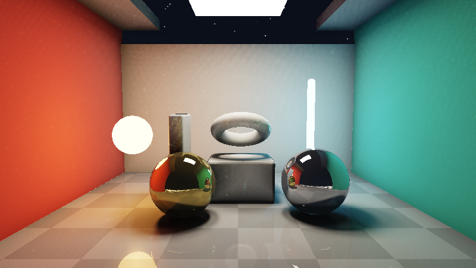
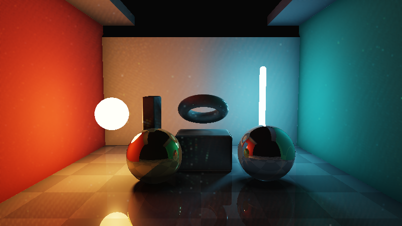
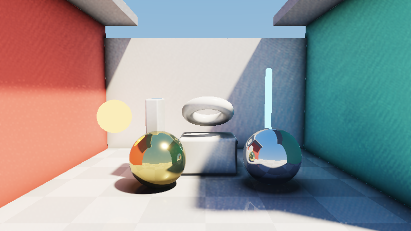
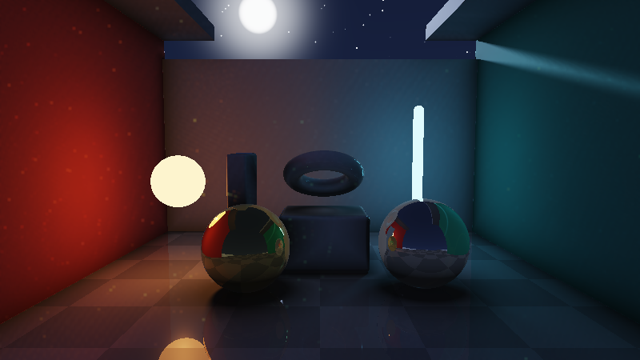

# C++20 SDF Lighting, Soft Shadows & Emissive GI Demo

Standalone multi-threaded C++20 SDF sphere-tracer (`main.cpp`) demonstrating:
- **Analytical SDF Soft Shadows** (`calcSdfSoftShadow`) with contact-to-penumbra widening
- **Emissive Lighting** (clipped-polygon LTC area panel + glowing SDF sphere & neon capsule geometry)
- **SDF Cone GI & AO + Bilateral Denoise** (`evalSdfConeGi` + edge-preserving `5x5` filter)
- **Multi-bounce SDF Reflections**
- **Sun, Moon & Starlight** illumination

## Build & Render

```bash
make render
```

## Screenshots

### 1. Emissive Night Lit (LTC Panel + Emissive Orb + Cyan Neon Tube)


### 2. Pure Emissive Geometry Only (Area Panel, Sun, Moon & Stars OFF)


### 3. Daylight Sun + Skylight + SDF Soft Shadows + SDF Cone GI


### 4. Night Moonlight + Starlight + Emissive Accent

